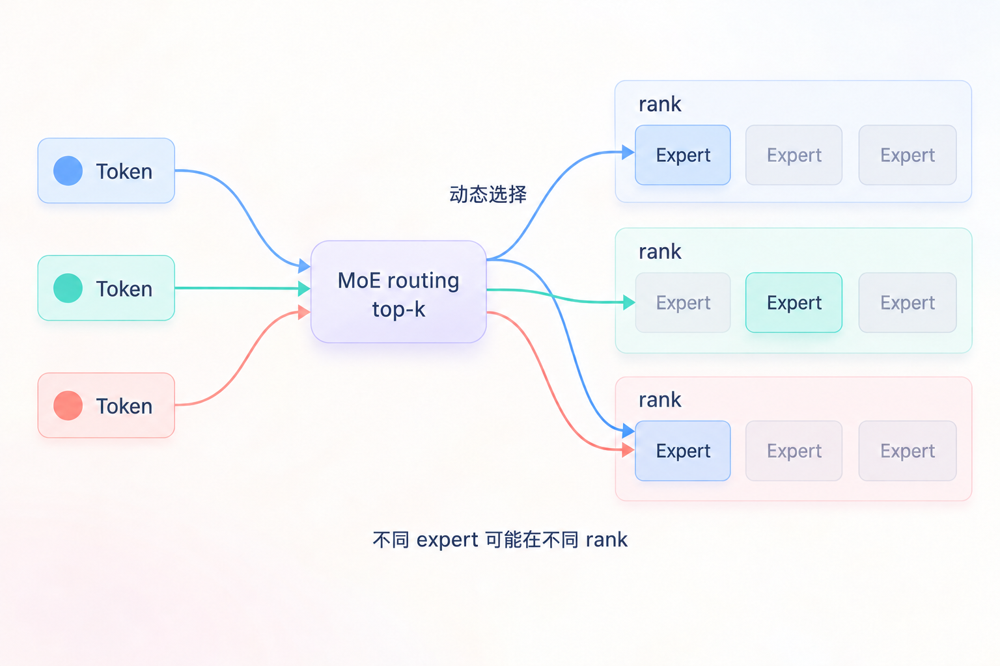
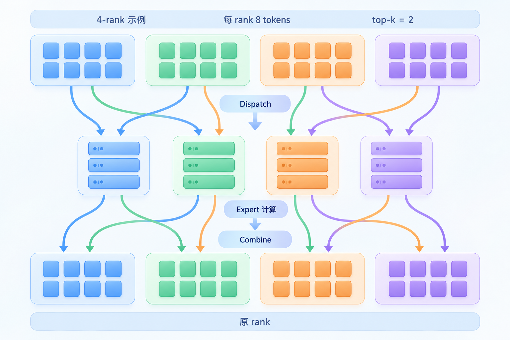
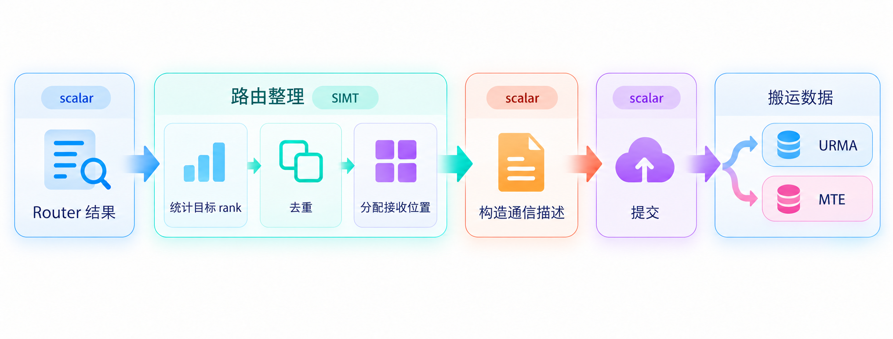
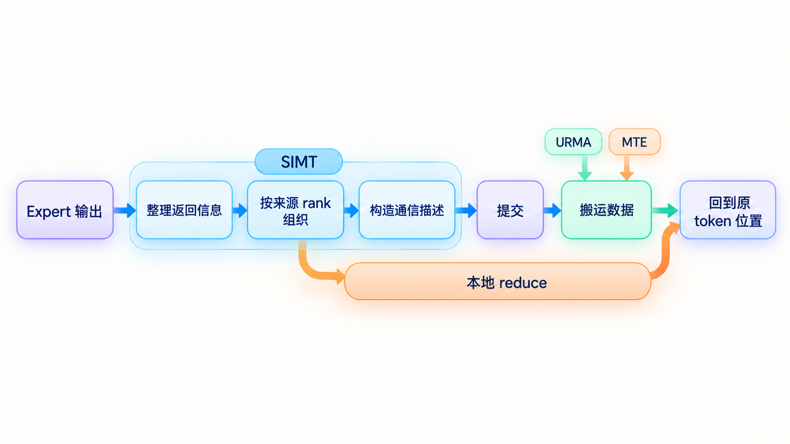
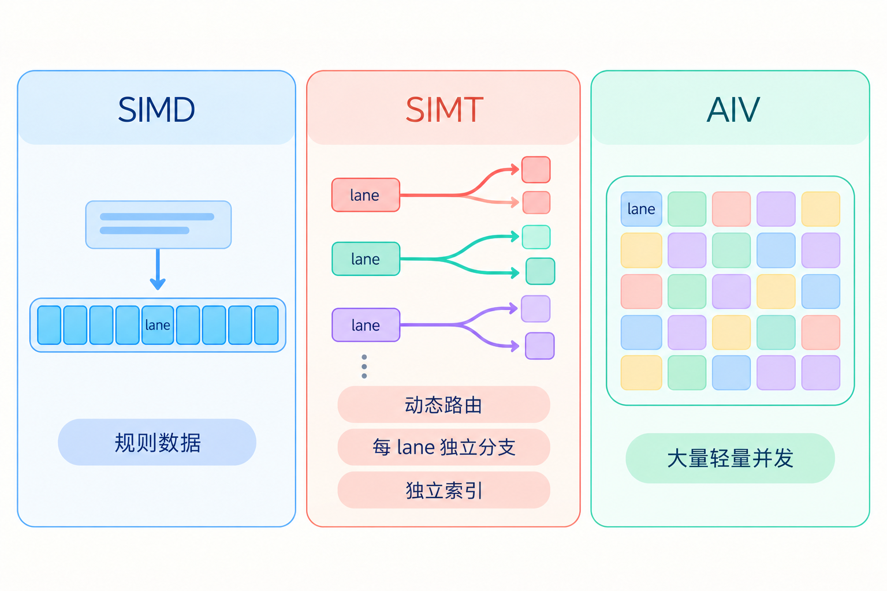
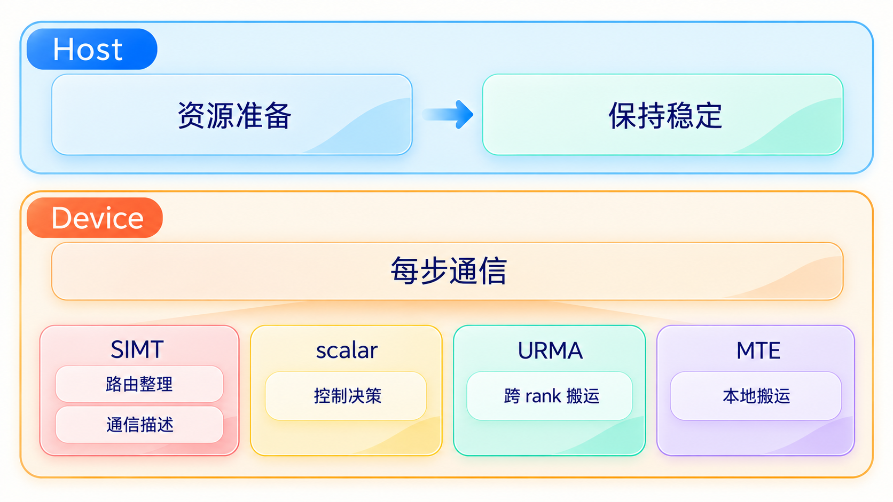

# DeepEP-Ascend：SIMT为什么适合MoE通信？

## 一分钟概览

MoE通信的难点不在于数据搬运本身，而在于发送前必须确定通信计划。

Router为每个token选择top-k expert，expert分布在多个rank上。因此，每个token的发送目标、对端接收位置，以及同一token多个结果的聚合方式，都必须在运行时根据路由结果确定。

[DeepEP-Ascend](https://github.com/deepseek-ai/DeepEP-Ascend)将这一动态决策过程留在`Device`侧：`SIMT`负责路由扫描、目标统计、去重、slot计算和通信描述构造；`URMA`/`MTE`负责按描述搬运payload。

`SIMT`的价值不是替代通信硬件，而在于高效处理“每个token各不相同”的分支、归约和字段构造。

## 1. MoE通信的业务背景

MoE模型包含Router。每个token进入模型时，Router会从大量expert中选出少量expert进行处理，这一机制通常称为top-k：每个token选择k个expert。

在多卡训练中，expert分布在不同rank上。rank可以理解为分布式训练中的一个参与方，每个rank负责一部分expert。由此产生两个必要的通信操作：

- Dispatch：把token发送到expert所在rank，并整理成expert能消费的布局；
- Combine：把expert输出送回token原始rank，并把top-k结果聚合成一个输出。

通信的复杂性在于，Router的选择每个step都会变化。token 0在这一step可能发送至rank 1和rank 2，在下一step可能发送至rank 0和rank 3；同一个rank也可能被多个token选中。因此，发送目标、每个rank的接收数量以及接收端的数据布局，都无法在运行前固定。

这类工作有三个特点：

- 动态：路由每个step都变化；
- 稀疏：不是每个rank都有等量数据；
- 不均衡：热门expert所在rank可能成为长尾。

图1：MoE routing。同一个token可能发送至多个rank，同一个rank也可能接收多个token；这些关系由每一步的top-k结果决定。

## 2. Dispatch与Combine的4-rank示例

以下使用一个简化示例：4个rank，每个rank本地有8个token，每个token选择2个expert。示例只保留业务信息，不展开队列、描述符字段等通信实现。

### 2.1 Dispatch：从Router结果到expert输入

Dispatch的输入是rank 0本地的8个token，以及Router为每个token选出的2个expert。假设路由结果如下：

| token | 选中的expert | expert所在rank | Dispatch操作 |
| --- | --- | --- | --- |
| 0 | E7, E10 | 1, 2 | 分别发送给rank 1和rank 2 |
| 1 | E3, E12 | 0, 3 | 本地保留一份，远端发送一份 |
| 2 | E5, E8 | 1, 1 | 两个expert都在rank 1，hidden只发一份 |
| 3 | E15, E2 | 2, 3 | 分别发送给rank 2和rank 3 |
| 4 | E1, E6 | 0, 1 | 本地保留一份，远端发送一份 |
| 5 | E9, E11 | 2, 2 | 两个expert都在rank 2，hidden只发一份 |
| 6 | E4, E14 | 0, 3 | 本地保留一份，远端发送一份 |
| 7 | E13, E16 | 1, 3 | 分别发送给rank 1和rank 3 |

由此可以得到Dispatch的业务结论：

- rank 0本地处理token 1、4、6；
- rank 1接收token 0、2、4、7；
- rank 2接收token 0、3、5；
- rank 3接收token 1、3、6、7。

发送数据前，还需要先形成一份通信清单：

1. 读取每个token的top-k结果；
2. 统计每个目标rank需接收的token数量；
3. 对同一token的重复rank去重，避免同一份数据发多次；
4. 计算对端接收slot，即token在接收端的存放位置；
5. 生成通信描述，说明数据段、发送目标和接收地址；
6. 提交描述，让通信硬件搬运payload。

去重仅作用于同一token的hidden数据。token 2的两个expert都位于rank 1，因此hidden只发送一份；E5和E8仍需分别消费这个token，接收端会根据expert信息将其展开为两个expert输入。token 5在rank 2的处理方式相同。最终，16个expert选择转换为14份hidden发送：3份留在本地，11份发送至远端；接收端展开后，仍形成16个expert输入。

### 2.2 Combine：从expert输出到token输出

expert计算完成后，每个输出都需要返回原始token所在的rank 0，并按Router给出的top-k权重聚合为一个输出。仍沿用上述路由：

| 原始token | 输出来源 | rank 0操作 |
| --- | --- | --- |
| 0 | rank 1的E7，rank 2的E10 | 加权聚合两个输出 |
| 1 | 本地E3，rank 3的E12 | 加权聚合本地与远端输出 |
| 2 | rank 1的E5和E8 | 加权聚合同一来源的两个输出 |
| 3 | rank 2的E15，rank 3的E2 | 加权聚合两个输出 |
| 4 | 本地E1，rank 1的E6 | 加权聚合本地与远端输出 |
| 5 | rank 2的E9和E11 | 加权聚合同一来源的两个输出 |
| 6 | 本地E4，rank 3的E14 | 加权聚合本地与远端输出 |
| 7 | rank 1的E13，rank 3的E16 | 加权聚合两个输出 |

Combine的业务流程如下：

1. 读取每个expert输出携带的metadata，包括source rank、原始token、expert和slot；
2. 按source rank组织返回工作，减少零散提交；
3. 远端expert输出生成远端写描述，由通信硬件写回rank 0；
4. 本地expert输出直接进入本地聚合；
5. rank 0根据原始token和slot，将多个expert输出加权reduce，并写回token输出位置。

Dispatch和Combine的业务方向相反，共同点在于：通信前都需要完成一层动态整理。Dispatch将“token到expert”的路由整理为发送清单；Combine将“expert输出到原始token”的返回关系整理为聚合计划。

图2：4-rank MoE流程。上半部分展示Dispatch，从8个token的top-k路由到SIMT整理，再到目标rank；下半部分展示Combine，从expert输出到SIMT返回整理，再到加权reduce输出。

从执行路径看，两者可以概括如下，其中重点标注`SIMT`承担的部分：

    Dispatch
      [SIMT] 读取top-k路由结果
      [SIMT] 统计目标rank / 去重 / 计算接收slot
      [SIMT] 构造通信描述
      [scalar] 提交通信描述
      [URMA/MTE] 搬运payload

    Combine
      [SIMT] 读取返回metadata：source rank / token / slot
      [SIMT] 按source rank组织task
      [SIMT] 构造远端写描述
      [scalar] 提交通信描述
      [URMA/MTE] 搬运payload
      [SIMT] 本地reduce / 写回目标位置

这份流程图是全文主线：后续Dispatch和Combine章节将按这些阶段解释`SIMT`的适配性。

## 3. Dispatch中的SIMT阶段

### 3.1 路由扫描：token天然并行

Dispatch的第一步是读取路由结果。这项工作天然适合`SIMT`：每个token的top-k判断彼此独立，多个token可以同时扫描。

如果将这些结果送回`Host`处理，`Device`需要先同步路由结果，`Host`生成通信计划后再下发执行。路由信息本身位于`Device`上，这一往返会引入同步和launch开销。DeepEP-Ascend因此选择在`Device`侧直接完成。

### 3.2 目标统计与去重：分支与归约

确定目标rank后，还需要回答两个问题：

1. 每个rank会收到多少token？
2. 同一个token是否命中了同一rank上的多个expert？

第一个问题需要统计；第二个问题需要去重。以token 2为例，两个expert均位于rank 1，payload只需发送一份，接收端再根据expert展开。

这些操作由大量比较、筛选、前缀和归约组成：判断目标rank是否相同、筛选第一次出现的rank、计算它在目标rank接收队列中的位置。这些操作虽然不规则，但高度并行，符合`SIMT`的执行形态。

### 3.3 接收slot计算：位置来自动态统计

接收端不能随意存放token。每个token都需要明确的接收slot，expert计算和Combine聚合都依赖该位置。

slot并非预先为某个token固定，而是根据“此前发送至同一个rank的token情况”动态计算。因此，它依赖上一节的统计和去重结果，也是典型的并行归约问题。

### 3.4 通信描述构造：动态路由的固定表达

经过上述阶段，动态路由已被整理为确定信息：目标rank、接收slot、payload位置和长度。最后一步是将这些信息转换为硬件可消费的通信描述。

通信描述可以类比为一张固定格式的寄货单，写明目标、地址和数据段。不同token的路由不同，但描述格式相同。`SIMT`可以按`lane`分工填写这些字段：一部分填写目标，一部分填写长度，一部分填写地址。多个`AIV`也可以同时处理各自的token段，分别生成描述。

图3：Dispatch数据流。左半段是动态路由，右半段是硬件按固定格式消费的通信描述。

### 3.5 提交与搬运：各执行路径分工

`SIMT`不承担实际payload搬运。描述构造完成后，由`scalar`维护明确的提交边界，`URMA`负责远端写入，`MTE`负责本地搬运。

这并不是单纯的任务拆分，而是按照执行路径的特点分工：`SIMT`处理不规则路由和描述构造；`scalar`维护提交顺序；`URMA`/`MTE`执行高效数据搬运。

## 4. Combine中的SIMT阶段

### 4.1 返回信息整理：source rank、token与slot

Combine的输入比Dispatch更分散。rank 0接收的expert输出可能来自不同source rank；每个输出还携带metadata，用于记录其所属原始token、接收slot以及参与的加权聚合。

这些metadata同样可以按token并行整理。`SIMT`读取后，将分散的结果还原为“每个原始token有哪些输入、分别来自哪里”。

### 4.2 task组织：零散结果的批次化

DeepEP-Ascend按task组织Combine。task并非模型层概念，而是通信上的分组，表示同一source rank的一组token结果。将同一目标的工作放在一个task中，可以减少零散提交，并提前构造远端写描述。

`SIMT`可以并行读取metadata、组织task，并为远端结果生成通信描述；本地结果则不需要远端写，直接进入本地聚合或写回目标位置。

图4：Combine数据流。远端结果构造通信描述后由URMA写入；本地结果直接聚合或写回目标位置。

### 4.3 流水执行：通信准备与本地reduce重叠

Combine并不严格要求“先构造完所有通信，再做本地聚合”。当前task执行本地reduce时，下一个task的metadata读取和通信描述构造可以并行推进。

这使通信准备与计算收尾形成流水线：远端写描述尽早提交，本地聚合无需等待全部描述构造完成。`SIMT`适合承担该流水线中的metadata整理和描述构造，因为每个task、每个token的工作同样不规则但可并行。

## 5. 为什么SIMT适合MoE通信

将Dispatch和Combine拆解后，`SIMT`的优势来自三个方面：结构契合、表达自然、并发友好。结构契合是指token天然并行，统计、去重和slot计算属于分支与归约；表达自然是指通信描述字段可按`lane`分工填写，动态路由能直接映射到线程组织；并发友好是指多个`AIV`能够同时整理路由并生成描述，避免工作集中在单一提交点。

| 工作 | 优势来源 | 执行路径 | 适配原因 |
| --- | --- | --- | --- |
| top-k扫描 | 结构契合 | SIMT | 每个token独立，可并行 |
| rank统计 | 结构契合 | SIMT | 动态分支加归约 |
| 重复rank去重 | 结构契合 | SIMT | 比较、筛选和前缀计算 |
| 接收slot计算 | 结构契合 | SIMT | 位置依赖动态统计结果 |
| 通信描述构造 | 表达自然 | SIMT | 字段可按lane并行填写 |
| 多AIV路由整理 | 并发友好 | SIMT | 每个AIV独立处理token段 |
| 提交边界 | 协作分工 | scalar | 需要明确的发布顺序 |
| payload搬运 | 硬件分工 | URMA/MTE | 硬件传输路径更高效 |

因此，`SIMT`的价值不是替代`URMA`，而是把“每个token各不相同的业务意图”转换为硬件可执行的规则描述。

`SIMD`与`SIMT`的关键差异在这里。`SIMD`由一条指令同时处理连续数据，适合规则、连续、少分支的向量计算；`SIMT`则由大量线程执行同一程序，每个线程可以走不同分支，并通过筛选、交换和归约原语协作。MoE通信符合后者的执行形态：不同token的目标rank不同，重复rank需要去重，接收slot来自动态前缀，通信描述字段也不同。如果只用规则向量计算表达这些逻辑，需要额外展开、掩码和中间状态；`SIMT`则能将这些分支和协作直接写入线程模型。

图5：SIMT适配MoE通信的原因。左侧是适合规则向量数据的SIMD；中间是可分支、可协作的SIMT token线程；右侧是多个AIV并行完成路由整理和通信描述构造。

图6：Host与Device的分工。Host负责资源初始化；Device侧完成动态路由、通信描述构造和硬件传输。

多`AIV`并发是另一个重要原因。每个`AIV`处理一段token，并拥有独立的待提交描述区间。因此，多个`AIV`可以同时完成路由统计和描述构造，避免所有producer集中在同一个提交点。

## 6. 性能证据与适用边界

DeepEP-Ascend官方性能报告给出以下带宽：

| EP size | Dispatch GB/s | Combine GB/s |
| ---: | ---: | ---: |
| EP8 | 373-375 | 345-347 |
| EP16 | 348-352 | 338-341 |
| EP32 | 335-340 | 320-324 |
| EP64 | 323-327 | 294-298 |
| EP128 | 313-320 | 272-278 |

统计口径包含通信描述提交和等待传输完成，不包含最终epilogue。Dispatch在EP32以内达到物理payload带宽的约90-95%。

这组数据说明：当动态路由和描述构造被有效并行化后，通信路径仍能接近硬件payload带宽。但这并不表示所有MoE workload都会获得相同结果；实际收益取决于token数、top-k、expert分布和rank间均衡度。

## 7. 结语

DeepEP-Ascend提供了一个清晰样例：MoE通信中最复杂的部分，是把动态top-k结果转换为确定的发送计划和通信描述。

这项工作正适合`SIMT`：token可并行，统计和去重属于分支与归约，通信描述字段可并行构造；`scalar`和`URMA`/`MTE`继续负责提交边界和payload搬运。

因此，通信并非仅是payload搬运。将不规则路由转换为规则描述，本身就是通信中的重要计算，而`SIMT`擅长这项计算。

## 术语表

- `AIV`：Ascend设备上的执行单元；
- `SIMT`：同一指令流驱动大量线程，适合并行处理独立数据；
- `lane`：`SIMT`执行中的线程编号，可用于分工填写通信描述字段；
- `Host` / `Device`：`Host`负责控制流和资源初始化，`Device`执行设备侧计算和通信路径；
- `scalar`：AICore上的标量执行路径，适合维护明确提交边界；
- `URMA`：负责远端写入的通信硬件路径；
- `MTE`：负责设备侧数据搬运的硬件路径。
