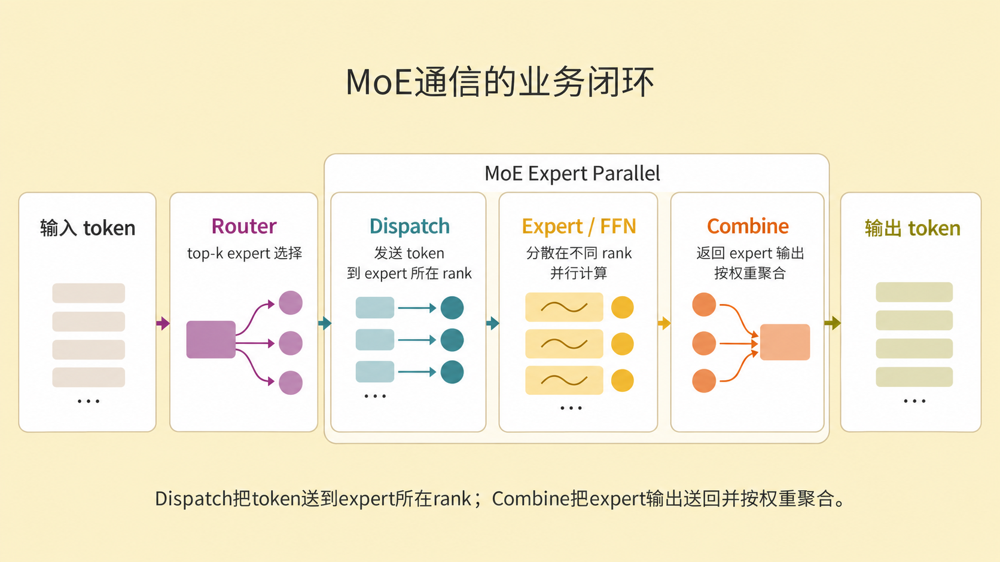
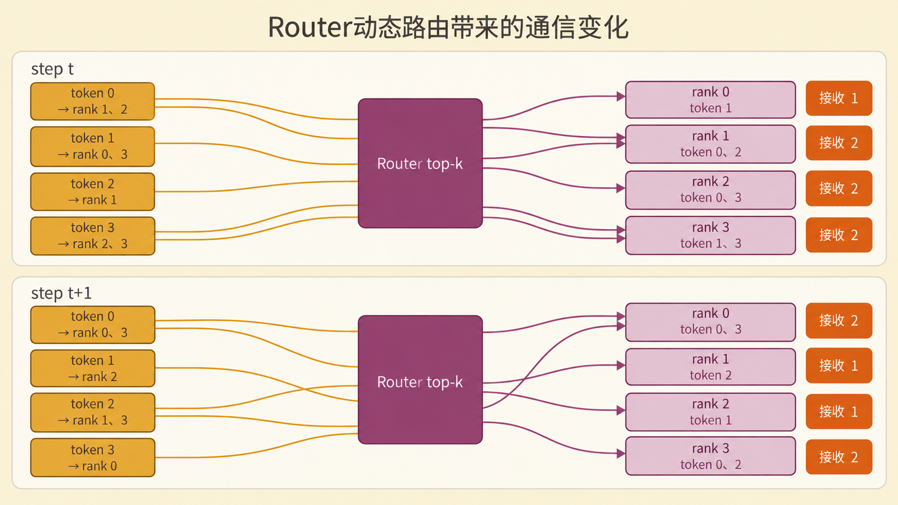
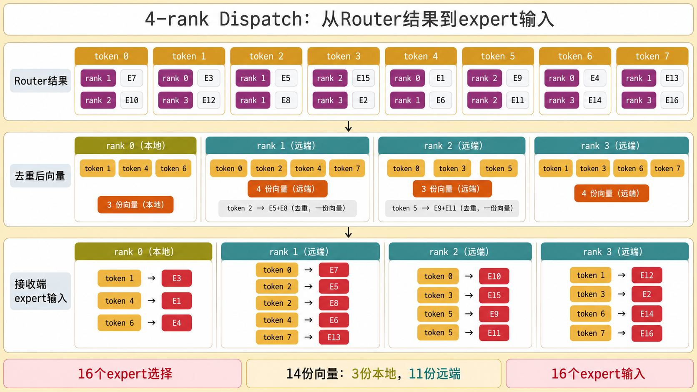
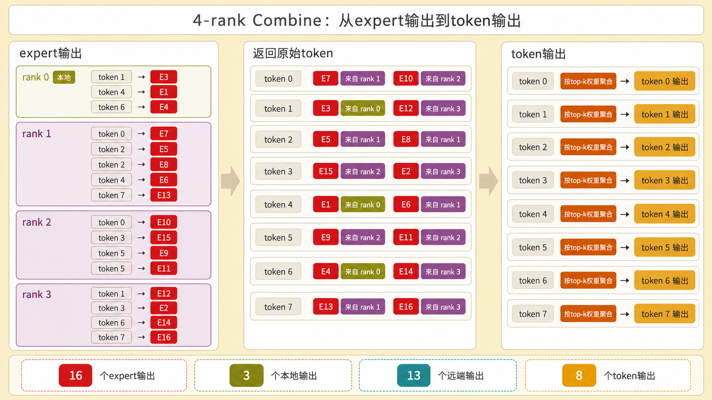
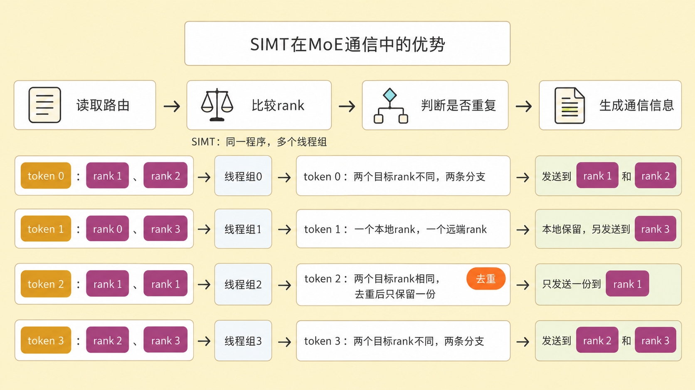
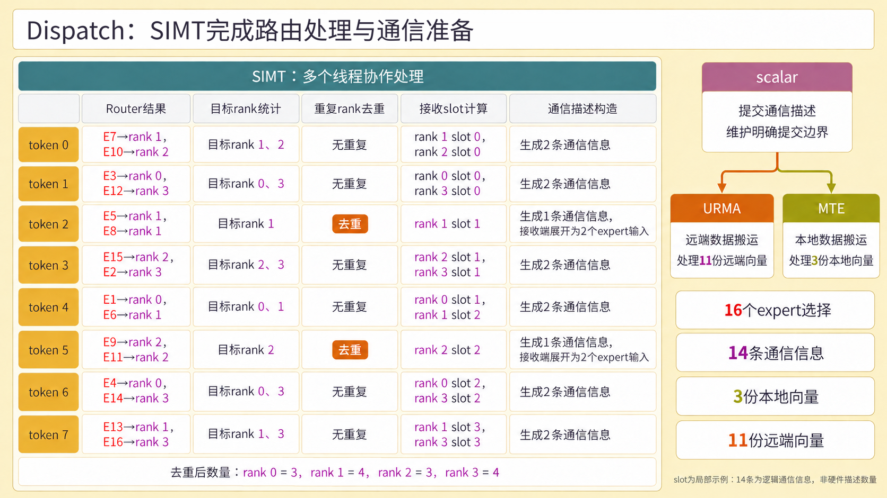
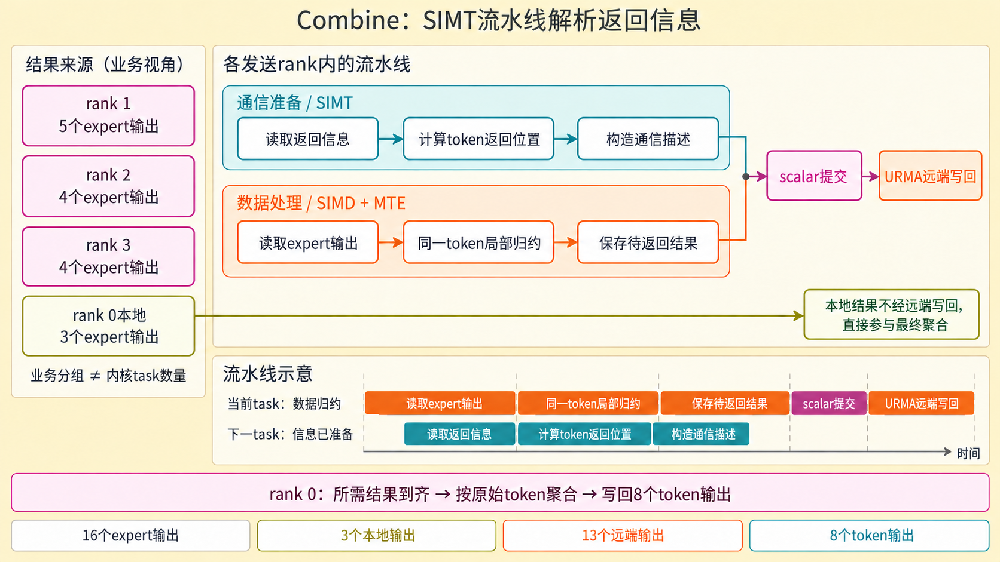

# DeepEP-Ascend：为什么SIMT适合MoE通信？

## 一分钟概览

MoE通信需要根据动态路由生成通信计划。Router为每个token选择的expert可能不同，且这些expert分布在多个rank上，因此发送目标、接收位置和结果返回关系都需要在运行时确定。

[DeepEP-Ascend](https://github.com/deepseek-ai/DeepEP-Ascend)将这部分通信预处理放在`Device`侧，用`SIMT`并行完成路由处理、目标统计、rank去重、位置计算和通信描述构造，直接利用设备上的路由结果生成通信计划。

`SIMT`通过线程组内协作处理单个token的路由，通过线程组间并行推进多个token的处理。这种执行方式能够自然表达不同token的目标判断、重复rank识别和通信字段构造。

通信描述准备就绪后，再由`URMA`/`MTE`执行数据搬运。`SIMT`的核心价值，是将动态、不规则的通信预处理并行化，让通信计划的生成更贴近MoE业务的执行特点。

## 1. MoE通信的业务背景

MoE（混合专家）模型由多个expert（专家）和一个Router（路由器）组成。每个token进入模型时，Router会从大量expert中选出少量expert，通常执行前馈网络（FFN）计算。这一选择机制称为top-k：每个token选择k个expert。

一次MoE计算从路由开始，经由expert计算，再回到原始token的输出：

图1：Router选择expert后，Dispatch把token送到对应rank，Expert/FFN完成计算，Combine把结果送回并按权重聚合。

在多卡训练或推理中，expert分布在不同rank上。rank表示一个参与计算的进程，本文示例可将其理解为一张卡。每个rank负责一部分expert，由此产生两个必要的通信操作：

- Dispatch：把token发送到expert所在rank，并按expert展开、构建可直接处理的输入布局；
- Combine：把expert输出送回token原始rank，并把top-k结果聚合成一个输出。

通信的复杂性来自Router的动态选择：token 0在这一步可能发送至rank 1和rank 2，下一步可能发送至rank 0和rank 3；同一个rank也可能被多个token选中。因此，发送目标、每个rank的接收数量以及接收端的数据布局，都无法在运行前固定。

图2：同一个token在不同step可能去往不同rank，各rank接收的token数量也随路由变化。图中数量只统计这4个示例token，并对同一token的目标rank去重。

MoE通信因此呈现三个特点：

- 动态：路由结果每一步都可能变化；
- 稀疏：每个token只选择全部expert中的少量expert；
- 不均衡：热门expert所在rank可能接收更多token，容易成为通信瓶颈。

## 2. Dispatch与Combine的4-rank示例

以下使用一个简化示例：4个rank，每个rank本地有8个token，每个token选择2个expert。这里只追踪rank 0的8个token，其他rank的token不计入图中的数量。expert编号及其所在rank按下表设定，用于说明业务关系。

### 2.1 Dispatch：从Router结果到expert输入

Dispatch的输入是rank 0本地的8个token，以及Router为每个token选出的2个expert。下表列出完整路由结果：

| token | 选中的expert | expert所在rank | Dispatch操作 |
| --- | --- | --- | --- |
| 0 | E7, E10 | 1, 2 | 分别发送给rank 1和rank 2 |
| 1 | E3, E12 | 0, 3 | 本地保留一份，远端发送一份 |
| 2 | E5, E8 | 1, 1 | 两个expert都在rank 1，向量只发一份 |
| 3 | E15, E2 | 2, 3 | 分别发送给rank 2和rank 3 |
| 4 | E1, E6 | 0, 1 | 本地保留一份，远端发送一份 |
| 5 | E9, E11 | 2, 2 | 两个expert都在rank 2，向量只发一份 |
| 6 | E4, E14 | 0, 3 | 本地保留一份，远端发送一份 |
| 7 | E13, E16 | 1, 3 | 分别发送给rank 1和rank 3 |

这8个token经过发送去重，再在接收端按expert展开，数据关系如下：

图3：同一token命中同一rank上的多个expert时，只保留一份向量。16个expert选择对应14份向量：3份留在本地，11份发送至远端；展开后仍形成16个expert输入。

由此可以得到rank 0的发送关系：

- rank 0本地处理token 1、4、6；
- rank 1接收token 0、2、4、7；
- rank 2接收token 0、3、5；
- rank 3接收token 1、3、6、7。

发送数据前，需要先形成一份通信清单：

1. 读取每个token的top-k结果；
2. 统计每个目标rank需接收的token数量；
3. 对同一token的重复rank去重，避免同一份数据发多次；
4. 计算对端接收slot，即token在接收端的存放位置；
5. 生成通信描述，说明数据段、发送目标和接收地址；
6. 提交描述，由通信硬件搬运数据。

去重仅作用于同一token的向量数据。token 2的两个expert都位于rank 1，因此向量只发送一份；E5和E8仍需分别处理这个token，接收端会根据expert信息将其展开为两个expert输入。token 5在rank 2的处理方式相同。最终，16个expert选择转换为14份向量发送：3份保留在本地，11份发送至远端；接收端展开后，仍形成16个expert输入。

### 2.2 Combine：从expert输出到token输出

expert计算完成后，每个输出都需要返回原始token所在的rank 0，并按Router给出的top-k权重聚合为一个输出。返回关系仍沿用上述路由：

| 原始token | 输出来源 | rank 0操作 |
| --- | --- | --- |
| 0 | rank 1的E7，rank 2的E10 | 加权聚合两个输出 |
| 1 | 本地E3，rank 3的E12 | 加权聚合本地与远端输出 |
| 2 | rank 1的E5和E8 | 加权聚合同一来源的两个输出 |
| 3 | rank 2的E15，rank 3的E2 | 加权聚合两个输出 |
| 4 | 本地E1，rank 1的E6 | 加权聚合本地与远端输出 |
| 5 | rank 2的E9和E11 | 加权聚合同一来源的两个输出 |
| 6 | 本地E4，rank 3的E14 | 加权聚合本地与远端输出 |
| 7 | rank 1的E13，rank 3的E16 | 加权聚合两个输出 |

这16个expert输出最终还原为8个token输出，本地与远端来源都参与同一token的聚合：

图4：16个expert输出中，3个来自本地，13个来自远端。每个token的两个expert结果按路由权重聚合，最终得到8个输出。

图中的13个远端输出是expert结果的数量。实现可以先在同一rank内合并同一token的多个结果，实际发送份数不一定等于expert输出数。按权重聚合描述的是模型业务：权重可以在expert侧应用，Combine再对已加权的结果求和。

Combine的业务流程如下：

1. 各expert所在rank读取返回信息，确定结果属于哪个原始token、需要返回哪个rank；
2. 按返回目标和token批次组织工作；同一token在该rank上的多个expert结果可以先局部归约；
3. 为需要返回远端的结果生成通信描述，准备就绪后由通信硬件写回原始rank；
4. 本地结果直接保留，无需远端传输；
5. 原始rank等待所需结果到齐，再按token聚合并写回输出。

Dispatch和Combine的业务方向相反，但都需要根据动态信息完成通信预处理：Dispatch根据“token到expert”的路由生成发送计划；Combine根据“expert输出到原始token”的返回关系生成聚合计划。

## 3. SIMT在MoE通信中的优势

前面的示例表明：不同token的目标不同，但路由处理的程序相同。SIMT可以让多个线程组执行这套程序：组内协作处理一个token的路由，组间并行处理不同token。

图5：多个线程组执行同一套路由处理程序，组内协作处理一个token的top-k目标，组间并行处理不同token。重复rank需要去重，本地与远端结果也需要不同处理。

这类工作与`SIMT`的匹配主要体现在三个方面：

- 结构契合：token可独立并行，统计、去重和slot计算属于分支与归约；
- 表达自然：通信描述字段可按`lane`分工填写，动态路由能直接映射到线程组织；
- 并发友好：多个`AIV`能够同时处理路由并生成描述，避免工作集中在单一提交点。

| 工作 | 优势来源 | 执行路径 | 适配原因 |
| --- | --- | --- | --- |
| top-k扫描 | 结构契合 | SIMT | token独立，可并行 |
| rank统计 | 结构契合 | SIMT | 动态分支加归约 |
| 重复rank去重 | 结构契合 | SIMT | 比较、筛选和前缀计算 |
| 接收slot计算 | 结构契合 | SIMT | 位置依赖动态统计结果 |
| 通信描述构造 | 表达自然 | SIMT | 字段可按lane并行填写 |
| 多AIV路由处理 | 并发友好 | SIMT | 每个AIV独立处理token段 |
| 提交边界 | 协作分工 | scalar | 需要明确的发布顺序 |
| 数据搬运 | 硬件分工 | URMA/MTE | 硬件传输路径更高效 |

`SIMT`将每个token各不相同的通信需求，转换为硬件可执行的规则描述，再交给传输路径执行。

`SIMD`用一条指令处理多个数据元素，适合规则、少分支的向量计算；`SIMT`由多个线程执行同一程序，各线程根据数据处理不同分支，并通过筛选、交换和归约协作。

具体到MoE通信，SIMT可以让线程组内的线程分工处理一个token的top-k目标，并协作完成rank去重；多个线程组则并行处理不同token。通信描述构造时，线程还可按目标、长度、地址等字段分工，从路由处理到描述生成发挥细粒度并行能力。

两种方式各有适合的工作。SIMD可以通过掩码等方式处理不规则数据；SIMT则更便于表达不同token的目标判断、重复rank去重和通信字段构造。在Combine中，连续向量的数值归约仍交给SIMD，SIMT解析返回信息。收益既来自表达方式与业务结构的匹配，也来自通信预处理的并行化和各阶段协作；实际性能还取决于分支分歧、线程协作和同步成本。

## 4. Dispatch中的SIMT阶段

图6把rank 0的8个token展开为并行的通信预处理过程：路由扫描、目标统计与去重、slot计算和描述构造。每个token的路由可以独立处理，统计和位置计算则需要线程间协作。

图6：SIMT处理8个token的路由，去重后形成14份向量的发送关系。slot只示意这批token在各目标rank内的位置；实际地址还要结合其他来源rank的计数。14份逻辑发送关系不等于14条硬件通信描述。

### 4.1 路由扫描：token独立并行

Dispatch的第一步是读取路由结果。这项工作与`SIMT`高度匹配：每个token的top-k判断彼此独立，多个token可以同时扫描。

如果将这些结果交给`Host`处理，`Device`需要先同步路由结果，`Host`生成通信计划后再下发执行。路由信息本身位于`Device`上，这一往返会引入同步和启动开销。DeepEP-Ascend因此选择在`Device`侧直接完成。

### 4.2 目标统计与去重：分支与归约

确定目标rank后，还需要回答两个问题：

1. 每个rank将接收多少token？
2. 同一个token是否命中同一rank上的多个expert？

第一个问题需要统计；第二个问题需要去重。以token 2为例，两个expert均位于rank 1，向量只需发送一份，接收端再根据expert展开。

这些操作由大量比较、筛选、前缀和归约组成：判断目标rank是否相同、保留第一次出现的rank、计算它在接收区域中的位置。它们虽然不规则，但具有较多可并行的工作，符合`SIMT`的执行形态。

### 4.3 接收slot计算：位置来自动态统计

接收端需要为每个token分配明确的接收slot；expert计算和Combine聚合都依赖该位置。

slot并非预先为某个token固定，而是根据目标rank的接收计数，以及token在发送批次中的相对顺序计算。实际接收布局还要结合其他来源rank的计数，因此图6中的编号仅是局部示例。计数汇总和前缀计算可以通过并行归约完成。

### 4.4 通信描述构造：动态路由的固定表达

经过上述阶段，已从动态路由中确定目标rank、接收slot、数据位置和长度。最后一步是将这些信息转换为硬件可执行的通信描述。

通信描述可以类比为一张固定格式的发货单，写明目标、地址和数据段。不同token的路由不同，但描述格式相同。`SIMT`可以按`lane`分工填写字段：一部分填写目标，一部分填写长度，一部分填写地址。多个`AIV`也可以同时处理各自的token段，分别生成描述。

### 4.5 提交与搬运：各执行路径分工

`SIMT`不承担实际数据搬运。描述构造完成后，由`scalar`维护明确的提交边界，`URMA`负责远端写入，`MTE`负责本地搬运。

这种划分遵循执行路径的特点：`SIMT`处理不规则路由和描述构造；`scalar`维护提交顺序；`URMA`/`MTE`执行高效数据搬运。

## 5. Combine中的SIMT阶段

Combine需要解析返回信息并处理expert输出向量。图7展示了各发送rank中SIMT、SIMD、MTE与scalar的执行分工。

图7：各发送rank组织自己的返回任务，交错推进返回信息解析与数据处理。结果来源数量沿用第2章案例，流水线只说明执行分工与依赖，不代表实际耗时比例。

### 5.1 返回信息解析：找到原始token与目标位置

expert计算完成后，结果分散在各expert所在rank。Dispatch保留的返回信息记录了原始token、其所属rank，以及expert输入与输出位置之间的对应关系。

发送端用`SIMT`并行读取这些信息，确定每个结果从哪里读取、返回哪个rank、放入哪个token对应的位置。业务目标各不相同，但计算地址和填写字段的程序可以并行执行。

### 5.2 task组织：按返回目标分批处理

DeepEP-Ascend把需要返回同一个目标rank的一批token结果组织为task。这里的目标rank是token原始所在的rank；task是执行批次，实际数量取决于token数量、批次大小和执行单元划分。图7中的4个结果来源分组只是业务视角，并不意味着内核固定执行4个task。

task划分后，`SIMT`并行读取其中各token的返回信息并构造远端写描述。同一rank上属于同一token的多个expert结果，可先由`SIMD`完成局部归约。以token 2为例，rank 1上的E5和E8可以先合并结果，再返回rank 0；本地结果直接保留。

### 5.3 流水执行：信息准备与数据处理协作

当前task执行必要的局部归约和数据搬运时，可以提前准备后续task的返回信息与通信描述，使各task交错推进。`SIMT`负责信息解析和描述构造，`SIMD`与`MTE`负责向量归约和搬运；数据与描述都准备就绪后，再由`scalar`提交远端传输。

发送端局部归约与接收端最终聚合是两个阶段。rank 0只有在所需结果到齐后，才能按原始token完成最终聚合；图7中的流水准备不意味着提前得到最终输出，也不意味着SIMT与SIMD在同一执行资源上同时运行。

## 6. 性能数据

DeepEP-Ascend的[官方性能报告](https://github.com/deepseek-ai/DeepEP-Ascend#performance)给出以下带宽数据。测试使用Ascend 950DT、CANN 9.2.0及报告说明的PoC HDK配置，通过netlayer 1网络通信；每rank容量为16,384个token，向量维度7168，top-6路由、256个expert。Dispatch使用FP8，Combine使用BF16。

| EP size | Dispatch GB/s | Combine GB/s |
| ---: | ---: | ---: |
| EP8 | 373-375 | 345-347 |
| EP16 | 348-352 | 338-341 |
| EP32 | 335-340 | 320-324 |
| EP64 | 323-327 | 294-298 |
| EP128 | 313-320 | 272-278 |

表中区间覆盖各rank的测量结果。计时包含通信提交和等待传输完成，排除最终后处理阶段，包括Dispatch的expert输入展开和Combine的最终聚合。按报告口径，Dispatch在EP32以内达到物理数据带宽上限的约90%-95%。

这组数据呈现的是完整实现中上述计时范围的通信吞吐，并非SIMT与SIMD的单独对照实验，不能据此计算SIMT带来的独立加速比。实际收益还取决于token数、top-k、expert分布和rank间均衡度。

## 7. 结语

DeepEP-Ascend展示了MoE通信中的一个关键环节：将动态top-k结果转换为确定的发送计划和通信描述。

这类工作与`SIMT`高度匹配：token可并行，统计和去重属于分支与归约，通信描述字段可并行构造；`scalar`和`URMA`/`MTE`继续负责提交边界和数据搬运。

因此，通信不只是数据搬运。将不规则路由转换为规则描述，本身就是通信中的重要计算，而`SIMT`擅长这类计算。

## 术语表

- `AIV`：Ascend设备上的执行单元；
- `SIMT`：同一指令流驱动大量线程，适合并行处理独立数据；
- `SIMD`：一条指令处理多个数据元素，适合规则的向量计算；
- `lane`：同一线程组内的线程位置编号，可用于分工填写通信描述字段；
- `slot`：接收区域中为token或返回结果安排的位置；
- `task`：按返回目标和token批次组织的一组执行工作；
- `Host` / `Device`：`Host`负责控制流和资源初始化，`Device`执行设备侧计算和通信路径；
- `scalar`：AICore上的标量执行路径，适合维护明确提交边界；
- `URMA`：负责远端写入的通信硬件路径；
- `MTE`：负责设备侧数据搬运的硬件路径。
