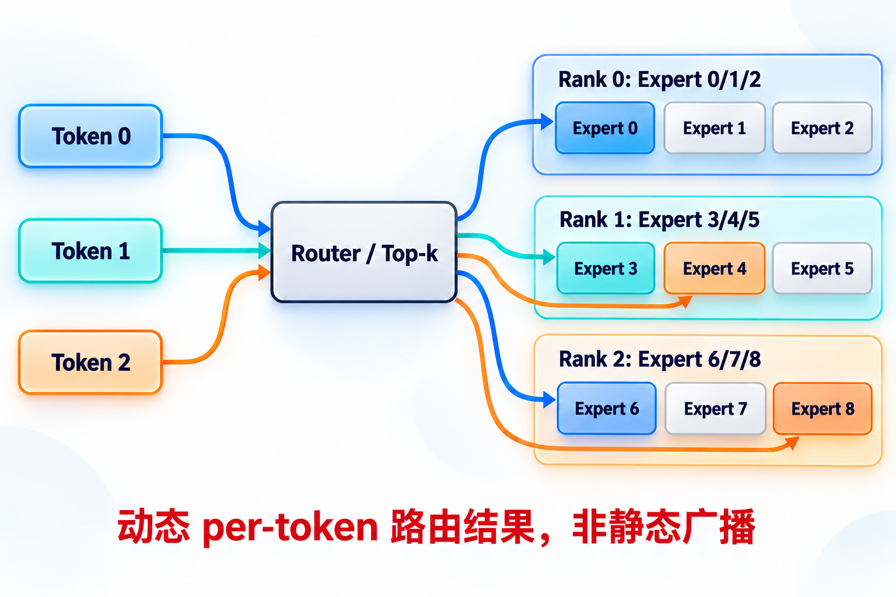
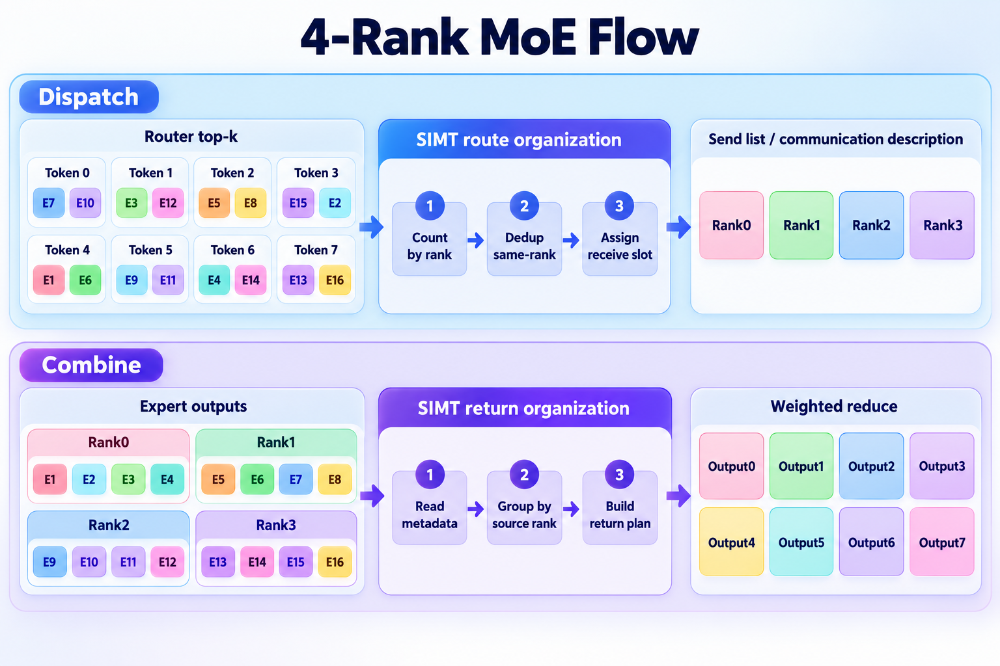
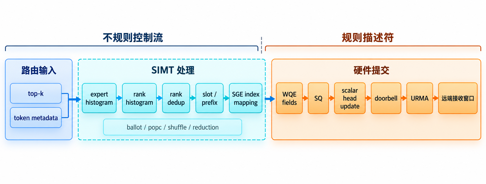
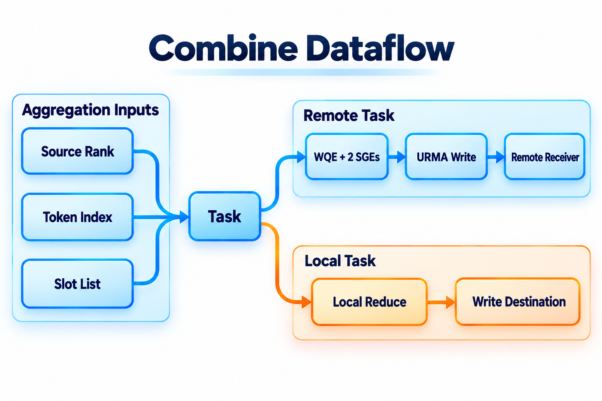
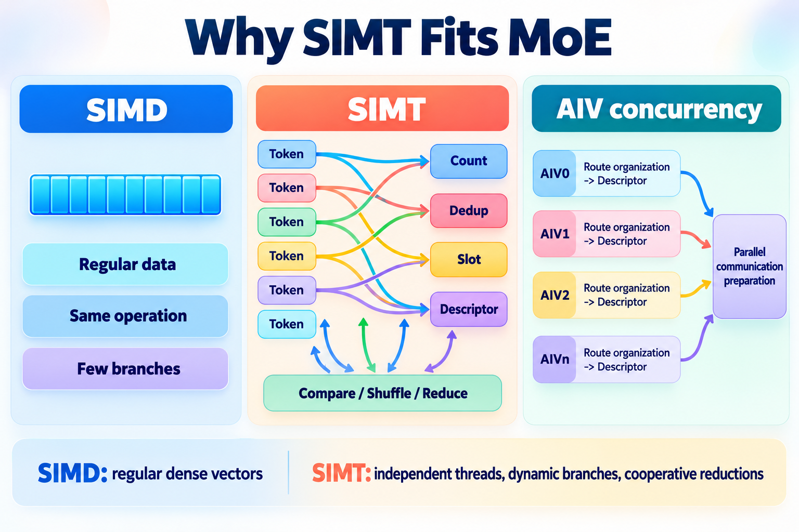
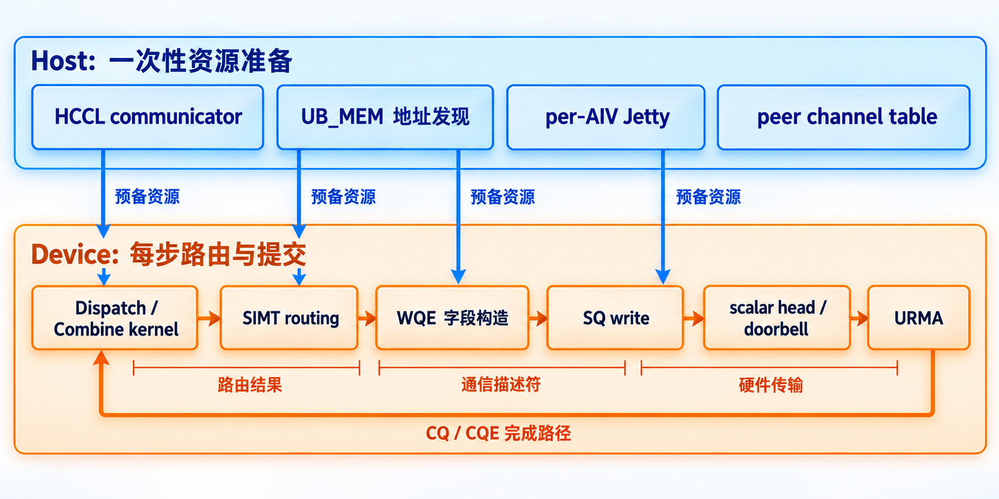

# DeepEP-Ascend：SIMT为什么适合MoE通信？

## 一分钟版

MoE通信的难点不是简单搬数据，而是先要知道怎么发。

Router为每个token选择top-k expert；expert分布在多个rank上。于是，每个token发给谁、对端收到后放在哪里、同一token的多个结果如何聚合，都要在运行时根据路由结果决定。

[DeepEP-Ascend](https://github.com/deepseek-ai/DeepEP-Ascend)把这段动态决策留在`Device`侧：`SIMT`负责路由扫描、目标统计、去重、slot计算和通信描述构造；`URMA`/`MTE`负责按描述搬运payload。

`SIMT`的优势不是替代通信硬件，而是擅长处理“每个token都不一样”的分支、归约和字段构造。

## 1. MoE通信的业务背景

MoE模型里有Router。每个token到来时，Router从大量expert中选出少量expert处理它，常见说法是top-k：每个token选k个expert。

在多卡训练中，expert会分布在不同rank上。rank可以先理解成分布式训练中的一个参与方，每个rank负责一部分expert。这样就有两个必要通信操作：

- Dispatch：把token发送到expert所在rank，并整理成expert能消费的布局；
- Combine：把expert输出送回token原始rank，并把top-k结果聚合成一个输出。

通信的麻烦在于，Router的选择每个step都会变。token 0这一步可能去rank 1和rank 2，下一步可能去rank 0和rank 3；同一个rank也可能被多个token选中。因此，发给谁、每个rank收多少、接收端怎么摆放，都无法在运行前固定。

这类工作有三个特点：

- 动态：路由每个step都变化；
- 稀疏：不是每个rank都有等量数据；
- 不均衡：热门expert所在rank可能成为长尾。

图1：MoE routing。同一个token可能去多个rank，同一个rank也可能接收多个token；这些关系由每一步的top-k结果决定。

## 2. Dispatch与Combine的4-rank示例

先看一个简化例子：4个rank，每个rank本地有8个token，每个token选2个expert。例子只保留业务信息，不展开队列、描述符字段等通信实现。

### 2.1 Dispatch：从Router结果到expert输入

Dispatch的输入是rank 0本地的8个token，以及Router为每个token选出的2个expert。假设路由结果如下：

| token | 选中的expert | expert所在rank | Dispatch要做什么 |
| --- | --- | --- | --- |
| 0 | E7, E10 | 1, 2 | 分别发送给rank 1和rank 2 |
| 1 | E3, E12 | 0, 3 | 本地保留一份，远端发送一份 |
| 2 | E5, E8 | 1, 1 | 两个expert都在rank 1，hidden只发一份 |
| 3 | E15, E2 | 2, 3 | 分别发送给rank 2和rank 3 |
| 4 | E1, E6 | 0, 1 | 本地保留一份，远端发送一份 |
| 5 | E9, E11 | 2, 2 | 两个expert都在rank 2，hidden只发一份 |
| 6 | E4, E14 | 0, 3 | 本地保留一份，远端发送一份 |
| 7 | E13, E16 | 1, 3 | 分别发送给rank 1和rank 3 |

从这张表可以得到Dispatch的业务结论：

- rank 0本地处理token 1、4、6；
- rank 1接收token 0、2、4、7；
- rank 2接收token 0、3、5；
- rank 3接收token 1、3、6、7。

这还不是简单地按表发数据。发送前要先得到一份通信清单：

1. 读取每个token的top-k结果；
2. 统计每个目标rank要接收多少token；
3. 对同一token的重复rank去重，避免同一份数据发多次；
4. 计算对端接收slot，即token在接收端摆放的位置；
5. 生成通信描述，告诉硬件发哪段数据、发给谁、放在哪里；
6. 提交描述，让通信硬件搬运payload。

去重只作用于同一token的hidden数据。token 2的两个expert都在rank 1，hidden发一份；但E5和E8都要消费这个token，接收端还要根据expert信息把它展开成两个expert输入。token 5在rank 2同理。于是，16个expert选择最终变成14份hidden发送：3份留在本地，11份发往远端；接收端展开后，仍是16个expert输入。

### 2.2 Combine：从expert输出到token输出

expert计算完成后，每个输出都要回到原始token所在的rank 0，并按Router给出的top-k权重聚合成一个输出。仍沿用上面的路由：

| 原始token | 输出来源 | rank 0要做什么 |
| --- | --- | --- |
| 0 | rank 1的E7，rank 2的E10 | 加权聚合两个输出 |
| 1 | 本地E3，rank 3的E12 | 加权聚合本地与远端输出 |
| 2 | rank 1的E5和E8 | 加权聚合同一来源的两个输出 |
| 3 | rank 2的E15，rank 3的E2 | 加权聚合两个输出 |
| 4 | 本地E1，rank 1的E6 | 加权聚合本地与远端输出 |
| 5 | rank 2的E9和E11 | 加权聚合同一来源的两个输出 |
| 6 | 本地E4，rank 3的E14 | 加权聚合本地与远端输出 |
| 7 | rank 1的E13，rank 3的E16 | 加权聚合两个输出 |

Combine的业务流程可以概括为：

1. 读取每个expert输出携带的metadata：它来自哪个source rank、属于哪个原始token、对应哪个expert和slot；
2. 按source rank组织返回工作，减少零散提交；
3. 远端expert输出生成远端写描述，由通信硬件写回rank 0；
4. 本地expert输出直接进入本地聚合；
5. rank 0根据原始token和slot，把多个expert输出加权reduce，写回token输出位置。

Dispatch和Combine的业务方向相反，但共同点是：通信前都有一层动态整理。Dispatch要把“token到expert”的路由整理成发送清单；Combine要把“expert输出到原始token”的返回关系整理成聚合计划。

图2：4-rank MoE流程。上排是Dispatch，从8个token的top-k路由到SIMT整理，再到目标rank；下排是Combine，从expert输出到SIMT返回整理，再到加权reduce输出。

从执行路径看，两者可以概括如下，重点标出`SIMT`承担的部分：

    Dispatch
      [SIMT] 读取top-k路由结果
      [SIMT] 统计目标rank / 去重 / 计算接收slot
      [SIMT] 构造通信描述
      [scalar] 提交通信描述
      [URMA/MTE] 搬运payload

    Combine
      [SIMT] 读取返回metadata：source rank / token / slot
      [SIMT] 按source rank组织task
      [SIMT] 构造远端写描述
      [scalar] 提交通信描述
      [URMA/MTE] 搬运payload
      [SIMT] 本地reduce / 写回目标位置

这张流程图是全文的主线：后面的Dispatch和Combine章节，只按这些阶段解释为什么`SIMT`合适。

## 3. Dispatch中的SIMT阶段

### 3.1 路由扫描：token天然并行

Dispatch的第一步是读取路由结果。这个工作天然适合`SIMT`：每个token的top-k判断彼此独立，多个token可以同时扫描。

如果把这些结果送回`Host`处理，`Device`要先同步路由结果，`Host`生成通信计划后再下发执行。路由信息本来就在`Device`上，这个往返会增加同步和launch开销。DeepEP-Ascend选择直接在`Device`侧完成。

### 3.2 目标统计与去重：分支与归约

知道目标rank后，还要回答两个问题：

1. 每个rank会收到多少token？
2. 同一个token是否命中了同一rank上的多个expert？

第一个问题需要统计；第二个问题需要去重。比如上表的token 2，两个expert都在rank 1，payload只需要发一份，接收端再按expert展开。

这些操作由大量比较、筛选、前缀和归约组成：判断目标rank是否相同、筛选第一次出现的rank、计算它在该rank接收队列中的位置。它们不规则，但高度并行，正好符合`SIMT`的执行形态。

### 3.3 接收slot计算：位置来自动态统计

接收端不能把token随机堆放。每个token都要有明确的接收slot，expert计算和Combine聚合都依赖这个位置。

slot不是提前为某个token固定的，而是根据“前面有哪些token也要去同一个rank”动态计算出来的。因此，它依赖上一节的统计和去重结果，也是典型的并行归约问题。

### 3.4 通信描述构造：动态路由的固定表达

到这里，动态路由已经被整理成确定信息：目标rank、接收slot、payload位置和长度。最后一步是把这些信息转换成硬件能消费的通信描述。

通信描述可以理解成一张固定格式的寄货单：写清目标、地址和数据段。不同token的路由不同，但描述格式相同。`SIMT`可以按`lane`分工填写这些字段：一部分填目标，一部分填长度，一部分填地址。多个`AIV`也可以同时处理各自的token段，分别生成描述。

图3：Dispatch数据流。左半段是动态路由，右半段是硬件按固定格式消费的通信描述。

### 3.5 提交与搬运：各执行路径分工

`SIMT`不负责实际搬payload。描述构造完成后，由`scalar`维护明确的提交边界，`URMA`负责远端写入，`MTE`负责本地搬运。

这不是简单地把工作分散给`SIMT`、`scalar`和硬件，而是让它们各做擅长的事：`SIMT`处理不规则路由和描述构造；`scalar`维护提交顺序；`URMA`/`MTE`执行高效数据搬运。

## 4. Combine中的SIMT阶段

### 4.1 返回信息整理：source rank、token与slot

Combine的输入比Dispatch更散。rank 0接收的expert输出可能来自不同source rank；每个输出还带着metadata，说明它属于哪个原始token、放在哪个slot、参与哪个加权聚合。

这些metadata同样可以按token并行整理。`SIMT`读取后，先把“散的结果”还原成“每个原始token有哪些输入、分别来自哪里”。

### 4.2 task组织：零散结果的批次化

DeepEP-Ascend把Combine按task组织。task不是模型层的概念，而是通信上的分组：同一source rank的一组token结果。把同一目标的工作放在一个task里，可以减少零散提交，也能提前构造远端写描述。

`SIMT`可以并行读取metadata、组织task，并为远端结果生成通信描述；本地结果则不需要远端写，直接进入本地聚合或写回目标位置。

图4：Combine数据流。远端结果构造通信描述后由URMA写入；本地结果直接聚合或写回目标位置。

### 4.3 流水执行：通信准备与本地reduce重叠

Combine不是严格地“先构造完所有通信，再做本地聚合”。当前task在做本地reduce时，下一个task的metadata读取和通信描述构造可以并行推进。

这让通信准备和计算收尾形成流水：远端写描述尽早提交，本地聚合不等待全部描述构造完成。`SIMT`适合承担这条流水中的metadata整理和描述构造，因为每个task、每个token的工作同样是不规则但可并行的。

## 5. 为什么SIMT适合MoE通信

把Dispatch和Combine拆开后，`SIMT`的优势来自三个层面：结构契合、表达自然、并发友好。结构契合指token天然并行，统计、去重和slot计算是分支加归约；表达自然指通信描述字段可按`lane`分工填写，动态路由能直接映射到线程组织；并发友好指多个`AIV`能同时整理路由并生成描述，避免集中在单一提交点上。

| 工作 | 优势来源 | 执行路径 | 原因 |
| --- | --- | --- | --- |
| top-k扫描 | 结构契合 | SIMT | 每个token独立，可并行 |
| rank统计 | 结构契合 | SIMT | 动态分支加归约 |
| 重复rank去重 | 结构契合 | SIMT | 比较、筛选和前缀计算 |
| 接收slot计算 | 结构契合 | SIMT | 位置依赖动态统计结果 |
| 通信描述构造 | 表达自然 | SIMT | 字段可按lane并行填写 |
| 多AIV路由整理 | 并发友好 | SIMT | 每个AIV独立处理token段 |
| 提交边界 | 协作分工 | scalar | 需要明确的发布顺序 |
| payload搬运 | 硬件分工 | URMA/MTE | 硬件传输路径更高效 |

因此，`SIMT`的价值不是替代`URMA`，而是把“每个token都不同的业务意图”转换成硬件能执行的规则描述。

`SIMD`和`SIMT`的差别也在这里。`SIMD`更偏一条指令同时处理连续数据，适合规则、连续、少分支的向量计算；`SIMT`则是大量线程执行同一程序，每个线程可以走不同分支，再通过筛选、交换和归约原语协作。MoE通信正好是后者：不同token的目标rank不同，重复rank要去重，接收slot来自动态前缀，通信描述字段也不同。如果只用规则向量计算表达这些逻辑，需要额外展开、掩码和中间状态；`SIMT`则能把这些分支和协作直接写进线程模型。

图5：SIMT适配MoE通信的原因。左侧是适合规则向量数据的SIMD；中间是可分支、可协作的SIMT token线程；右侧是多个AIV并行完成路由整理和通信描述构造。

图6：Host与Device的分工。Host负责资源初始化；Device侧完成动态路由、通信描述构造和硬件传输。

多`AIV`并发是另一半原因。每个`AIV`处理一段token，并拥有自己的提交队列。这样，多个`AIV`可以同时完成路由统计和描述构造，避免所有producer都挤在同一个提交点上。

## 6. 性能证据与适用边界

DeepEP-Ascend官方性能报告给出以下带宽：

| EP size | Dispatch GB/s | Combine GB/s |
| ---: | ---: | ---: |
| EP8 | 373-375 | 345-347 |
| EP16 | 348-352 | 338-341 |
| EP32 | 335-340 | 320-324 |
| EP64 | 323-327 | 294-298 |
| EP128 | 313-320 | 272-278 |

统计口径包含通信描述提交和等待传输完成，排除最终epilogue。Dispatch在EP32以内达到物理payload带宽的约90-95%。

这组数据说明：当动态路由和描述构造被有效并行化后，通信路径仍能接近硬件payload带宽。它不表示所有MoE workload都有相同结果；实际收益取决于token数、top-k、expert分布和rank间均衡度。

## 7. 延伸阅读：staged transport

本文没有展开队列和描述符的底层布局。工程上还有一种staged transport路线：producer先生成语义化的通信请求，再由专职transport service把这些请求转换成通信描述并统一提交。

这种分层更容易封装队列所有权、提交顺序和错误诊断，也让不同producer复用同一套通信语义；代价是请求编码、service调度和中间状态传递。它和DeepEP-Ascend的direct path是两种工程取舍，适合哪些场景，可以在后续文章中继续展开。

## 8. 结语

DeepEP-Ascend提供了一个清晰的样例：MoE通信中最难的部分，是把动态top-k结果变成确定的发送计划和通信描述。

这件事正适合`SIMT`：token可并行，统计和去重是分支加归约，通信描述字段可并行构造；`scalar`和`URMA`/`MTE`继续负责提交边界和payload搬运。

所以，通信不只是搬payload。把不规则路由变成规则描述，本身就是通信里的重要计算，而`SIMT`擅长这项计算。

## 附录：通信实现名词速查

- `AIV`：Ascend设备上的执行单元；
- `SIMT`：同一指令流驱动大量线程，适合并行处理独立数据；
- `lane`：`SIMT`执行中的线程编号，可用于分工填写通信描述字段；
- `Host` / `Device`：`Host`负责控制流和资源初始化，`Device`执行设备侧计算和通信路径；
- `scalar`：AICore上的标量执行路径，适合维护明确提交边界；
- `URMA`：负责远端写入的通信硬件路径；
- `MTE`：负责设备侧数据搬运的硬件路径。

## 参考入口

- [DeepEP-Ascend仓库](https://github.com/deepseek-ai/DeepEP-Ascend)
