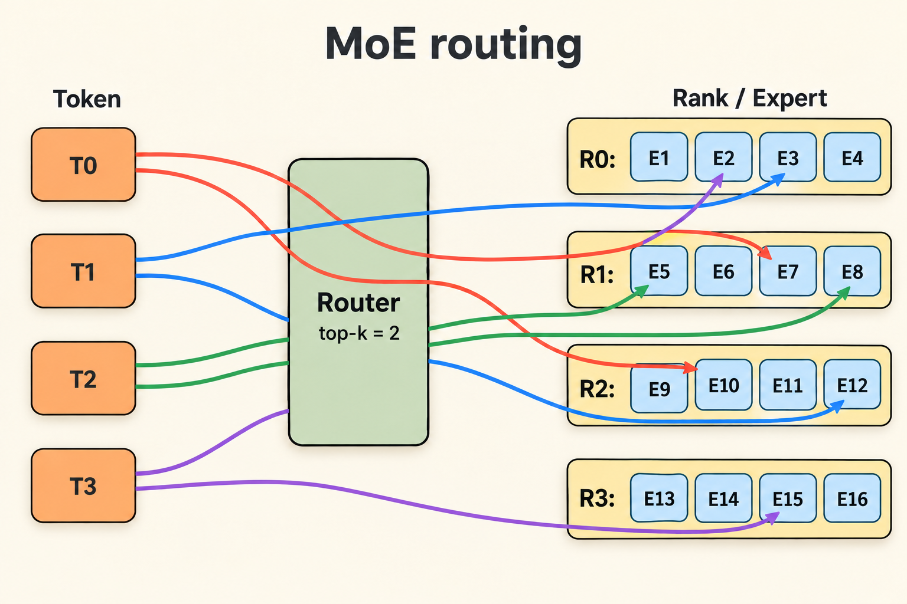
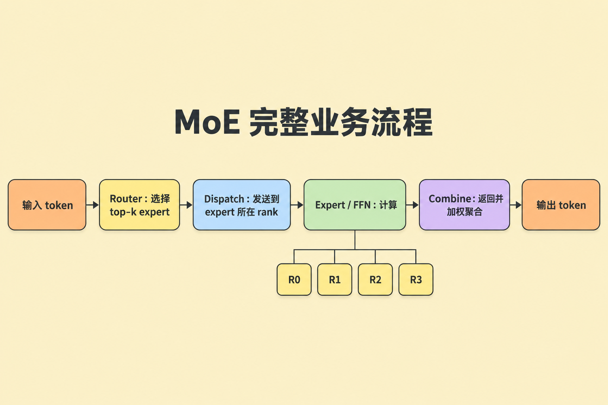
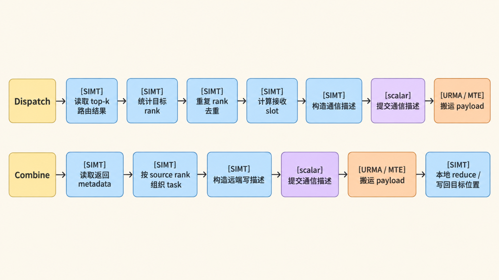
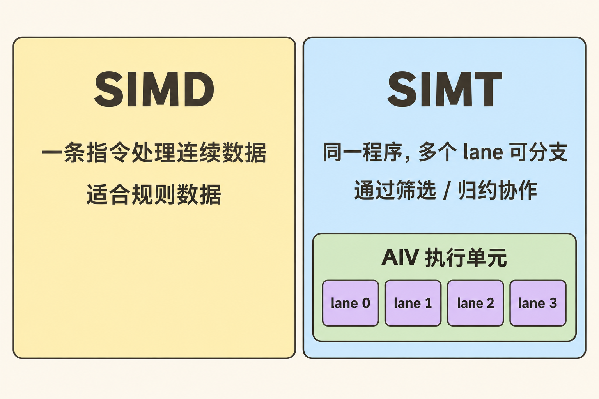
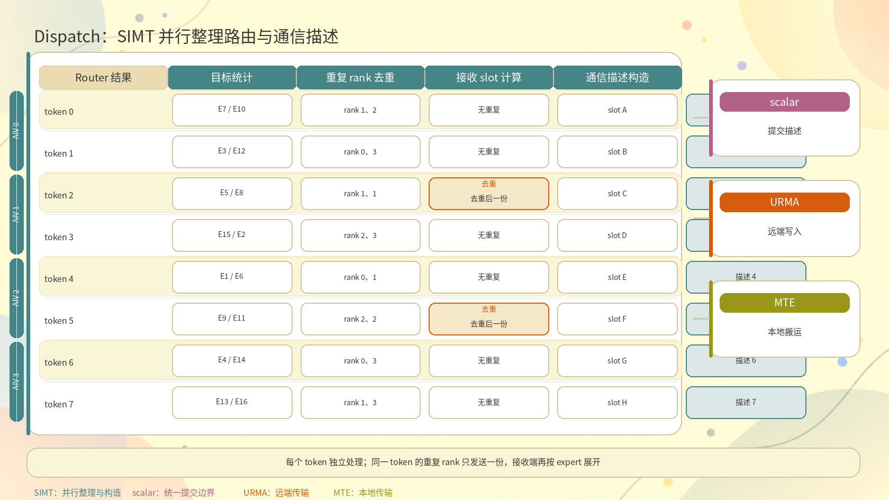
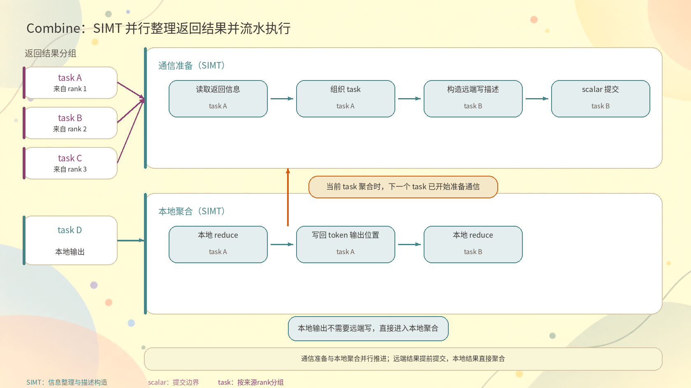

# DeepEP-Ascend：为什么SIMT适合MoE通信？

## 一分钟概览

MoE通信的难点不在数据搬运本身，而在发送前如何确定通信计划。

Router为每个token选择top-k expert，而这些expert分布在多个rank上。因此，每个token的发送目标、接收端存放位置，以及同一token多个结果的聚合方式，都必须在运行时确定。

[DeepEP-Ascend](https://github.com/deepseek-ai/DeepEP-Ascend)将这一动态决策过程放在`Device`侧：`SIMT`负责路由扫描、目标统计、去重、slot计算和通信描述构造；`URMA`/`MTE`负责按描述搬运数据。

`SIMT`的价值不在于替代通信硬件，而在于高效处理“每个token各不相同”的分支、归约和字段构造。

## 1. MoE通信的业务背景

MoE模型由多个expert和一个Router组成。每个token进入模型时，Router会从大量expert中选出少量expert。这一机制通常称为top-k：每个token选择k个expert。

在多卡训练中，expert分布在不同rank上。rank表示一个参与训练的计算单元，每个rank负责一部分expert。由此产生两个必要的通信操作：

- Dispatch：把token发送到expert所在rank，并整理成expert可直接处理的输入布局；
- Combine：把expert输出送回token原始rank，并把top-k结果聚合成一个输出。

通信的复杂性来自Router的动态选择：token 0在这一步可能发送至rank 1和rank 2，下一步可能发送至rank 0和rank 3；同一个rank也可能被多个token选中。因此，发送目标、每个rank的接收数量以及接收端的数据布局，都无法在运行前固定。

MoE通信因此呈现三个特点：

- 动态：路由结果每一步都可能变化；
- 稀疏：每个rank接收的数据量通常不相等；
- 不均衡：热门expert所在rank可能接收更多token，容易成为通信瓶颈。

图1：MoE routing。左侧token经过Router选择top-k expert，连线终止在右侧具体expert上。

图2：MoE完整业务流程。Router选择expert，Dispatch发送token，Expert/FFN计算，Combine返回并加权聚合。

## 2. Dispatch与Combine的4-rank示例

以下使用一个简化示例：4个rank，每个rank本地有8个token，每个token选择2个expert。示例先给出路由表和返回关系，再由图3拆解通信操作。

### 2.1 Dispatch：从Router结果到expert输入

Dispatch的输入是rank 0本地的8个token，以及Router为每个token选出的2个expert。图1展示token、expert与rank的对应关系，下表列出完整的8-token路由结果：

| token | 选中的expert | expert所在rank | Dispatch操作 |
| --- | --- | --- | --- |
| 0 | E7, E10 | 1, 2 | 分别发送给rank 1和rank 2 |
| 1 | E3, E12 | 0, 3 | 本地保留一份，远端发送一份 |
| 2 | E5, E8 | 1, 1 | 两个expert都在rank 1，向量只发一份 |
| 3 | E15, E2 | 2, 3 | 分别发送给rank 2和rank 3 |
| 4 | E1, E6 | 0, 1 | 本地保留一份，远端发送一份 |
| 5 | E9, E11 | 2, 2 | 两个expert都在rank 2，向量只发一份 |
| 6 | E4, E14 | 0, 3 | 本地保留一份，远端发送一份 |
| 7 | E13, E16 | 1, 3 | 分别发送给rank 1和rank 3 |

由此可以整理出rank 0的发送关系：

- rank 0本地处理token 1、4、6；
- rank 1接收token 0、2、4、7；
- rank 2接收token 0、3、5；
- rank 3接收token 1、3、6、7。

发送数据前，需要先形成一份通信清单：

1. 读取每个token的top-k结果；
2. 统计每个目标rank需接收的token数量；
3. 对同一token的重复rank去重，避免同一份数据发多次；
4. 计算对端接收slot，即token在接收端的存放位置；
5. 生成通信描述，说明数据段、发送目标和接收地址；
6. 提交描述，由通信硬件搬运数据。

去重仅作用于同一token的向量数据。token 2的两个expert都位于rank 1，因此向量只发送一份；E5和E8仍需分别处理这个token，接收端会根据expert信息将其展开为两个expert输入。token 5在rank 2的处理方式相同。最终，16个expert选择转换为14份向量发送：3份保留在本地，11份发送至远端；接收端展开后，仍形成16个expert输入。

### 2.2 Combine：从expert输出到token输出

expert计算完成后，每个输出都需要返回原始token所在的rank 0，并按Router给出的top-k权重聚合为一个输出。返回关系仍沿用上述路由：

| 原始token | 输出来源 | rank 0操作 |
| --- | --- | --- |
| 0 | rank 1的E7，rank 2的E10 | 加权聚合两个输出 |
| 1 | 本地E3，rank 3的E12 | 加权聚合本地与远端输出 |
| 2 | rank 1的E5和E8 | 加权聚合同一来源的两个输出 |
| 3 | rank 2的E15，rank 3的E2 | 加权聚合两个输出 |
| 4 | 本地E1，rank 1的E6 | 加权聚合本地与远端输出 |
| 5 | rank 2的E9和E11 | 加权聚合同一来源的两个输出 |
| 6 | 本地E4，rank 3的E14 | 加权聚合本地与远端输出 |
| 7 | rank 1的E13，rank 3的E16 | 加权聚合两个输出 |

Combine的业务流程如下：

1. 读取每个expert输出携带的返回信息，包括来源rank、原始token、expert和slot；
2. 按来源rank组织返回工作，减少零散提交；
3. 远端expert输出生成远端写描述，由通信硬件写回rank 0；
4. 本地expert输出直接进入本地聚合；
5. rank 0根据原始token和slot，将多个expert输出加权reduce，并写回token输出位置。

Dispatch和Combine的业务方向相反，但通信前都需要完成一层动态整理：Dispatch将“token到expert”的路由整理为发送清单；Combine将“expert输出到原始token”的返回关系整理为聚合计划。

图3：Dispatch与Combine操作拆解。节点颜色和角色徽标标明SIMT、scalar与URMA/MTE的执行路径。

## 3. 为什么SIMT适合MoE通信

将Dispatch和Combine拆解后，可以看到`SIMT`的三类优势：

- 结构契合：token可独立并行，统计、去重和slot计算属于分支与归约；
- 表达自然：通信描述字段可按`lane`分工填写，动态路由能直接映射到线程组织；
- 并发友好：多个`AIV`能够同时整理路由并生成描述，避免工作集中在单一提交点。

| 工作 | 优势来源 | 执行路径 | 适配原因 |
| --- | --- | --- | --- |
| top-k扫描 | 结构契合 | SIMT | token独立，可并行 |
| rank统计 | 结构契合 | SIMT | 动态分支加归约 |
| 重复rank去重 | 结构契合 | SIMT | 比较、筛选和前缀计算 |
| 接收slot计算 | 结构契合 | SIMT | 位置依赖动态统计结果 |
| 通信描述构造 | 表达自然 | SIMT | 字段可按lane并行填写 |
| 多AIV路由整理 | 并发友好 | SIMT | 每个AIV独立处理token段 |
| 提交边界 | 协作分工 | scalar | 需要明确的发布顺序 |
| 数据搬运 | 硬件分工 | URMA/MTE | 硬件传输路径更高效 |

因此，`SIMT`并不替代`URMA`，而是把每个token各不相同的通信需求，转换为硬件可执行的规则描述。

`SIMD`与`SIMT`的差异也体现在这里。`SIMD`由一条指令同时处理连续数据，适合规则、连续、少分支的向量计算；`SIMT`则由大量线程执行同一程序，每个线程可执行不同分支，并通过筛选、交换和归约操作协作。MoE通信更符合后者的执行形态：不同token的目标rank不同，重复rank需要去重，接收slot来自动态前缀，通信描述字段也不同。如果只用规则向量计算表达这些逻辑，需要额外展开、掩码和中间状态；`SIMT`则能将这些分支和协作直接写入线程模型。

图4：Why SIMT。左卡展示SIMD，右卡展示SIMT；AIV作为SIMT卡片内部的执行单元，lane只出现在AIV内部。

## 4. Dispatch中的SIMT阶段

图5先给出整体执行方式：8个token分别进入不同AIV，再同步推进路由扫描、目标统计、去重、slot计算和描述构造。后续小节按这张图的阶段展开。

图5：Dispatch的SIMT并行流程。8个token按AIV分组并行推进目标统计、去重、slot计算和描述构造，随后交给scalar提交和URMA/MTE搬运。

### 4.1 路由扫描：token独立并行

Dispatch的第一步是读取路由结果。这项工作与`SIMT`高度匹配：每个token的top-k判断彼此独立，多个token可以同时扫描。

如果将这些结果交给`Host`处理，`Device`需要先同步路由结果，`Host`生成通信计划后再下发执行。路由信息本身位于`Device`上，这一往返会引入同步和启动开销。DeepEP-Ascend因此选择在`Device`侧直接完成。

### 4.2 目标统计与去重：分支与归约

确定目标rank后，还需要回答两个问题：

1. 每个rank将接收多少token？
2. 同一个token是否命中同一rank上的多个expert？

第一个问题需要统计；第二个问题需要去重。以token 2为例，两个expert均位于rank 1，向量只需发送一份，接收端再根据expert展开。

这些操作由大量比较、筛选、前缀和归约组成：判断目标rank是否相同、筛选第一次出现的rank、计算它在目标rank接收队列中的位置。它们虽然不规则，但高度并行，符合`SIMT`的执行形态。

### 4.3 接收slot计算：位置来自动态统计

接收端需要为每个token分配明确的接收slot；expert计算和Combine聚合都依赖该位置。

slot并非预先为某个token固定，而是根据“此前发送至同一个rank的token情况”动态计算。因此，它依赖上一节的统计和去重结果，也是典型的并行归约问题。

### 4.4 通信描述构造：动态路由的固定表达

经过上述阶段，动态路由已被整理为确定信息：目标rank、接收slot、数据位置和长度。最后一步是将这些信息转换为硬件可执行的通信描述。

通信描述可以类比为一张固定格式的发货单，写明目标、地址和数据段。不同token的路由不同，但描述格式相同。`SIMT`可以按`lane`分工填写字段：一部分填写目标，一部分填写长度，一部分填写地址。多个`AIV`也可以同时处理各自的token段，分别生成描述。

### 4.5 提交与搬运：各执行路径分工

`SIMT`不承担实际数据搬运。描述构造完成后，由`scalar`维护明确的提交边界，`URMA`负责远端写入，`MTE`负责本地搬运。

这种划分遵循执行路径的特点：`SIMT`处理不规则路由和描述构造；`scalar`维护提交顺序；`URMA`/`MTE`执行高效数据搬运。

## 5. Combine中的SIMT阶段

图6从task视角展示Combine：返回结果先按来源rank分组，通信准备与本地聚合形成流水线。后续小节解释每个环节中SIMT承担的工作。

图6：Combine的SIMT流水线。返回结果按来源rank组织为task；当前task做本地reduce时，下一个task的通信准备已经推进。

### 5.1 返回信息整理：来源rank、token与slot

Combine的输入比Dispatch更分散。rank 0接收的expert输出可能来自不同rank；每个输出还携带返回信息，记录其所属原始token、接收slot以及参与的加权聚合。

这些返回信息同样可以按token并行整理。`SIMT`读取后，将分散结果还原为“每个原始token有哪些输入、分别来自哪里”。

### 5.2 task组织：零散结果的批次化

DeepEP-Ascend按task组织Combine。task并非模型层概念，而是通信上的分组，表示来自同一个rank的一组token结果。将返回工作按来源归组，可以减少零散提交，并提前构造远端写描述。

`SIMT`可以并行读取返回信息、组织task，并为远端结果生成通信描述；本地结果则不需要远端写，直接进入本地聚合或写回目标位置。

### 5.3 流水执行：通信准备与本地reduce重叠

Combine并不严格要求“先构造完所有通信，再做本地聚合”。当前task执行本地reduce时，下一个task的返回信息读取和通信描述构造可以并行推进。

通信准备与本地聚合由此形成流水线：远端写描述尽早提交，本地聚合无需等待全部描述构造完成。`SIMT`适合承担流水线中的返回信息整理和描述构造，因为每个task、每个token的工作同样不规则但可并行。

多`AIV`并发是另一个重要原因。每个`AIV`处理一段token，并拥有独立的待提交描述区间。多个`AIV`因此可以同时完成路由统计和描述构造，避免所有工作集中在同一个提交点。

## 6. 性能数据

DeepEP-Ascend官方性能报告给出以下带宽数据：

| EP size | Dispatch GB/s | Combine GB/s |
| ---: | ---: | ---: |
| EP8 | 373-375 | 345-347 |
| EP16 | 348-352 | 338-341 |
| EP32 | 335-340 | 320-324 |
| EP64 | 323-327 | 294-298 |
| EP128 | 313-320 | 272-278 |

统计范围包含通信描述提交和等待传输完成，不包含最后的模型计算阶段。Dispatch在EP32以内达到物理数据带宽的约90%-95%。

这组数据说明：当动态路由和描述构造被有效并行化后，通信路径仍能接近硬件数据带宽。但这并不表示所有MoE负载都会得到相同结果；实际收益取决于token数、top-k、expert分布和rank间均衡度。

## 7. 结语

DeepEP-Ascend给出了一个清晰示例：MoE通信中最复杂的部分，是将动态top-k结果转换为确定的发送计划和通信描述。

这类工作与`SIMT`高度匹配：token可并行，统计和去重属于分支与归约，通信描述字段可并行构造；`scalar`和`URMA`/`MTE`继续负责提交边界和数据搬运。

因此，通信不只是数据搬运。将不规则路由转换为规则描述，本身就是通信中的重要计算，而`SIMT`擅长这类计算。

## 术语表

- `AIV`：Ascend设备上的执行单元；
- `SIMT`：同一指令流驱动大量线程，适合并行处理独立数据；
- `lane`：`SIMT`执行中的线程编号，可用于分工填写通信描述字段；
- `Host` / `Device`：`Host`负责控制流和资源初始化，`Device`执行设备侧计算和通信路径；
- `scalar`：AICore上的标量执行路径，适合维护明确提交边界；
- `URMA`：负责远端写入的通信硬件路径；
- `MTE`：负责设备侧数据搬运的硬件路径。
