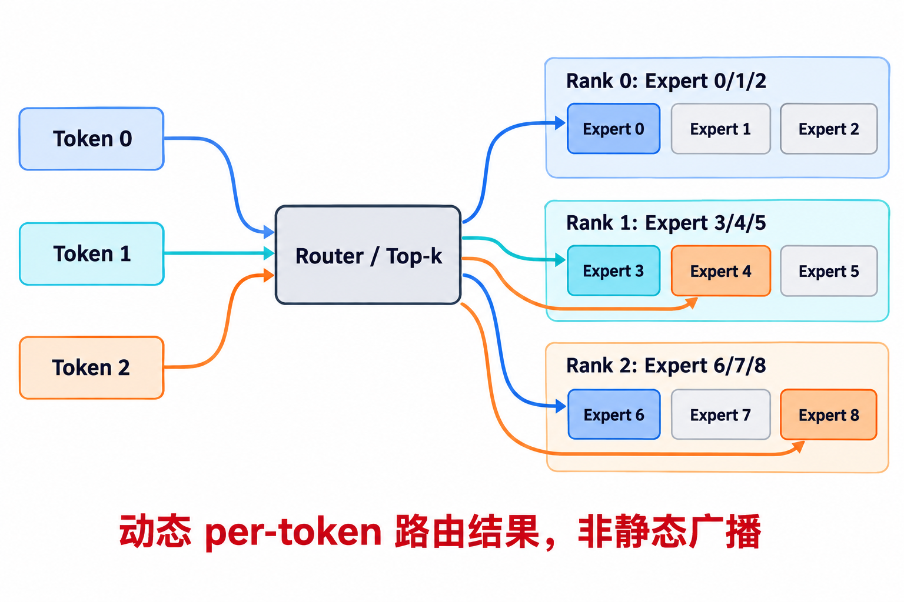
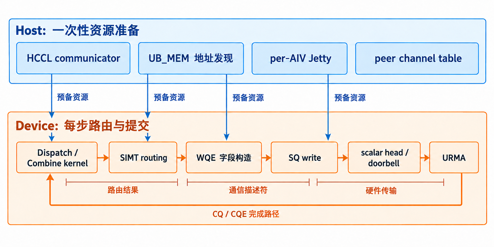
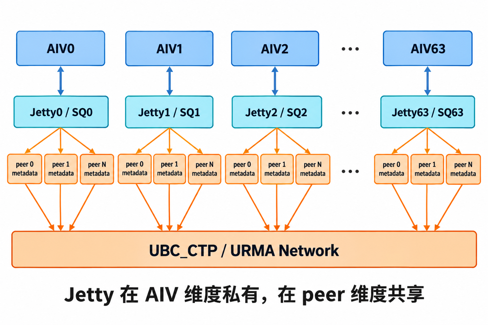
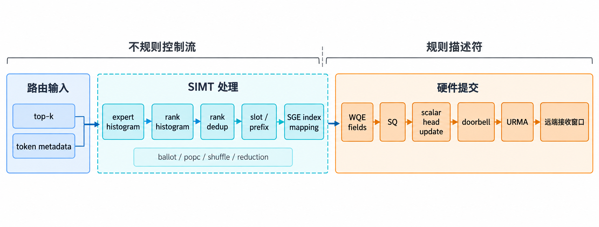
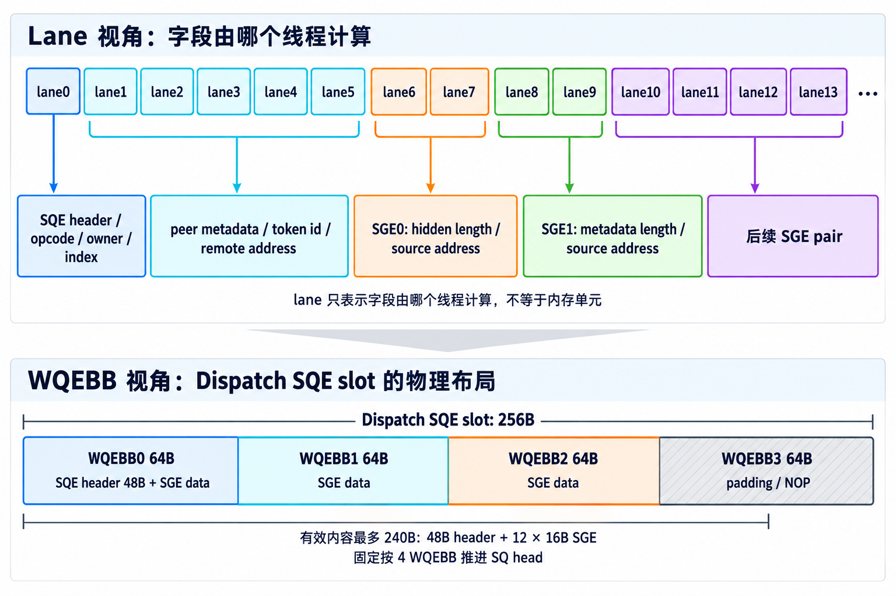

# DeepEP-Ascend：SIMT 为什么适合 MoE 通信？

## 一分钟版

MoE 通信的难点，不在“搬数据”，而在“知道搬给谁”。

Router 输出 top-k 后，每个 token 的目标 expert、目标 rank、接收 slot 和 payload 长度都不同。DeepEP-Ascend 把这层转换留在 Device 侧：SIMT worker 并行完成路由统计、去重、槽位分配和 WQE 字段构造；每个 AIV 拥有独立 Jetty/SQ；WQE 里的 SGE 直接指向本地 payload，URMA 负责写入远端窗口。

一句话：SIMT 把不规则的路由结果编译成规则描述符，URMA 按描述符把 payload 搬到远端。

## 阅读说明

本文面向做 MoE、分布式通信或 Ascend 后端的工程师，介绍 DeepEP-Ascend 的设备侧通信路径。只需要先记住三个概念：

- Host / Device 执行模型：Host 负责 Python/C++ 控制流、资源初始化和 kernel launch，Device 上的 AICore/AIV 执行算子；
- 专家并行（Expert Parallelism，EP）：expert 分布在不同 rank 上，token 需要跨 rank 流动；
- 一次远端写入（one-sided write）：发送端描述“把本地这段数据写到 peer 的某个地址”，接收端不需要同时调用匹配的 receive。

本文以 GitHub 仓库为准。GitCode 上的 ASC-COMM 报告描述更高层 API，两者不是同一层实现，后文单独说明。

## 1. 问题：路由每一步都在变

Router 输出 top-k 之后，通信才进入最难的一段。

假设 256 个 expert 分布在 8 个 rank 上，每个 token 选 6 个 expert。token 0 可能去 rank 1 的 expert 19，也可能同时去 rank 5 的 expert 180；token 1 又是另一组目标。发给谁、每个 rank 收多少、每个 token 写到哪个 slot，都无法在运行前固定。

这类通信有三个特点：

- 动态：路由每一步都变；
- 稀疏：不是每个 peer 都有等量数据；
- 不均衡：热门 expert 所在 rank 可能成为尾部。

如果把这段逻辑放回 Host，路径会变长：Device 算出路由，同步回 Host；Host 生成通信计划；Device 再继续后处理。路由信息本来就在 Device 上，来回搬运换来的主要是同步和 launch 开销。

DeepEP-Ascend 的选择是：让 SIMT 直接读路由结果，生成 slot 和 WQE 字段；让每个 AIV 拥有自己的 Jetty/SQ，多个 AIV 并行准备通信描述符。

图 1：MoE routing。同一个 token 可能去多个 rank，同一个 rank 上也可能有多个目标 expert；通信目标来自每一步的 top-k 结果，不是静态 broadcast。

## 2. 总体路径：Host 建资源，Device 拼描述符

实现的边界并不复杂。

Host 做一次性准备：复用 HCCL communicator，选择 netlayer 1 的 SuperPoD 外部 Clos 通路，发现远端地址，按 AIV 数量创建 Jetty endpoint，并把 channel 表交给 Device。

Device 做每步路由和提交：SIMT worker 读取 top-k 和 metadata，完成 histogram、去重、prefix 和 slot 分配；把 WQE 写入本 AIV 的 SQ；scalar 更新 head 并 ring doorbell；URMA 根据 SGE 和远端地址写 payload。

图 2：Host 与 Device 的分工。Host 只负责一次性资源准备；Device 侧把动态路由、通信描述符和硬件传输串成一条路径。

图的核心是边界：SIMT 处理动态路由，scalar 发布提交边界，URMA 执行硬件传输。

这里也要划清一个容易误读的边界：DeepEP-Ascend 不是“每个 lane 各自 ring doorbell”。SIMT 负责并行构造 WQE；WQE 写入 SQ 后，由该 AIV 的 scalar 侧更新 head 并发布 doorbell。lane 只参与字段构造，不直接发布提交边界。

## 3. 关键设计：每个 AIV 一个 Jetty

这一节的关键是区分 Jetty 和 Channel。

Jetty 是本地提交端点。它对应本 AIV 的一组 SQ/CQ 和 doorbell，回答的是“从哪个本地队列提交”。Channel 是建在 Jetty 上的连接上下文。它通过 ChannelEntity 描述远端 endpoint、远端注册内存和本队列的 SQ/CQ context，回答的是“如何找到对端资源”。

所以关系不是并列的：

    Jetty endpoint
      └── Channel
            └── ChannelEntity
                  ├── remoteBuffer
                  ├── sqContext
                  └── cqContext

一个 Jetty 可以关联多个 Channel；一个 Channel 只属于一个 Jetty。

DeepEP-Ascend 的选择不是“每个 peer 一个 Jetty”，而是“每个 AIV 一个 Jetty”。AIV0 有 Jetty0/SQ0，AIV1 有 Jetty1/SQ1，直到 AIV63 有 Jetty63/SQ63。不同 AIV 不共享 Jetty，因此不会同时写同一个 SQ；一个 Jetty 又可以服务多个 peer，peer 信息从 Channel 表里取。

Host 侧的 acquire_jetties 会创建两类东西：

1. num_jetties 个 Jetty endpoint，数量来自 runtime 的设备 AIV 数；
2. max(num_jetties, num_peers) 个 Channel，形成 Device 侧的 channel 表。

在 8 rank / 64 AIV 下，num_peers 是 7，num_jetties 是 64，所以 Host 创建 64 个 Channel。Device 侧的表名叫 jetty_ptrs，里面实际存的是 ChannelHandle，这个名字有些误导。它的用法分两类：

1. AIV i 用 jetty_ptrs[i] 找到自己的 ChannelEntity，再解析出本 AIV 的 SQ/CQ；
2. AIV 用前 num_peers 个 Channel 解析远端 peer 的 Jetty metadata、远端内存地址和 token。

也就是说，AIV 的提交队列来自自己的 Jetty/Channel，远端地址信息来自 peer 对应的 Channel，SIMT 把这两部分拼成 WQE。

这个设计的核心是队列所有权。多个 AIV 同时写同一个 SQ，就要处理 slot 预留、head 推进、owner bit 和 doorbell 顺序。每 AIV 一个 Jetty 绕开了这层竞争。

Host 还要求所有 peer 使用同一个 local UBC_CTP endpoint。Device 因此可以按 AIV index 选 Jetty，按 peer index 选远端 metadata。

图 3：per-AIV Jetty。Jetty 在 AIV 维度私有，在 peer 维度共享；每个 AIV 推进自己的 SQ，避免多个 producer 争用同一个队列。

## 4. Dispatch：把 token 发给 expert 所在 rank

Dispatch 的业务目标是：Router 已经为每个 token 选出 top-k expert，Dispatch 负责把这些 token 送到对应 expert 所在的 rank，并把结果整理成 expert 可以消费的布局。

实现上，它要把不规则的 top-k 结果转换成规则的四件事：发给哪个 rank、写入哪个接收 slot、携带哪些 hidden/metadata payload、这些 payload 由哪些 WQE 描述。

### 4.1 每个 AIV 负责一段连续 token

DeepEP-Ascend Dispatch 把连续的 token range 分给 AIV，每个 AIV 内部启动 512 个 SIMT thread。这样本地 copy 和 metadata 预取更友好，通信也分布在多个 Jetty/SQ 上。

### 4.2 SIMT 处理最不规则的几步

SIMT worker 读取 top-k 后，先做三件事：

1. 统计 expert histogram，知道每个 expert 要接收多少 token；
2. 统计 rank histogram，知道每个 peer 要接收多少 token；
3. 对同一个 token 的重复目标 rank 去重。如果一个 token 命中同一 rank 上的多个 expert，只向该 rank 发送一份 payload，接收端再按 expert 展开。

这些步骤落在 SIMT 擅长的范围。top-k 选择项可以映射到 lane；ballot、popc、shuffle、warp reduction 分别回答“是否重复”“重复位置在哪”“前缀和是多少”。这不是规则大块搬运，而是大量分支、比较和归约。

去重后，worker 为远端 entry 分配 SGE index，建立 sgep_to_entry 映射，再计算 SQE 区间和接收 slot。到这里，token 路由已经变成硬件布局。

图 4：Dispatch 数据流。左半段是不规则的路由控制流，右半段是硬件可以按固定格式消费的 WQE 描述符。

### 4.3 WQE 字段按 lane 展开

先区分两层：WQE 是逻辑上的提交描述符；WQEBB 是 SQ 里的 64B 物理块。一个 WQE 可以跨多个 WQEBB。Dispatch 的一个 SQE slot 固定占 4 个 WQEBB，也就是 256B；有效内容最多是 48B SQE header 加 12 个 16B SGE，共 240B，剩余空间用 padding/NOP 补齐。

WQE 不是由一个线程串行填出来的，而是按字段映射到 lane。lane 是 warp 内的线程编号。512 个 SIMT thread 会分成 16 个 warp；路由扫描按 top-k 分组处理 token，WQE 构造阶段再把 SQE 分片分配给这些 warp。

字段布局本身按 u64 word 组织：SQE header 使用 6 个 word；每个 SGE pair 使用 4 个 word，也就是两个 16B SGE。lane 的职责是并行计算这些 word：

| lane | 字段 |
| --- | --- |
| 0 | SQE header / opcode / owner / index |
| 1-5 | peer metadata / token id / remote address |
| 6-7 | SGE 0：hidden length / source address |
| 8-9 | SGE 1：metadata length / source address |
| 10-13 | 后续 SGE pair，每个 pair 4 个 lane |
| 14 以后 | 未参与本 SQE 有效字段，物理块内补 padding/NOP |

SIMT worker 算出 sqe_word 后，用 asc_stcg 写到 SQ。写入地址由 SQE slot 的起始 WQEBB 和 lane 所属 word 决定；lane 14 以后即使不填有效字段，最终 slot 仍按 4 个 WQEBB 推进。因此图 5 展示的是“字段来源”，不是完整 SQ 内存图。

图 5：lane 到 WQE 字段的映射。图中重点是 lane0 到 lane13 分别提供 header、peer metadata 和 SGE 字段；完整 Dispatch SQE slot 会扩展到 4 个 WQEBB，并用 padding/NOP 补齐。

### 4.4 远端 payload 不先进 UB

WQE 中的 SGE 直接指向本地 payload：

- hidden payload：指向输入 x；
- metadata payload：指向 metadata_send_buffer；
- FP8 场景还会携带 scale factors。

URMA 根据远端地址和 SGE 中的本地地址，直接写远端接收窗口。跨 rank 的 token 数据不先进 UB，也不经过 Host。

本地 rank 是例外。为了把本地 token 写到本地接收窗口，kernel 仍会用 MTE 做一段 GM 到 UB 再到 GM 的 local copy。所以更准确的说法是“远端 URMA payload 不先进 UB”，而不是整个 Dispatch 完全没有 UB 搬运。

最后一个 SQE 设置 strong order、fence 和 CQE，覆盖前面的写入。SIMT 完成字段构造后，scalar 更新 SQ head 并 ring doorbell。benchmark 再用 barrier 等待 URMA traffic，得到包含 issue 和 drain 的时间。

## 5. Combine：把 expert 输出送回原 rank 并聚合

Combine 的业务目标和 Dispatch 相反：Dispatch 把 token 发给 expert 所在 rank；Combine 要把 expert 输出送回 token 原来的 rank，并把同一个 token 的 top-k 份结果加权聚合成一份输出。

因此每个 token 有三类信息要处理：它来自哪个 source rank、它的原始 token index、它参与 reduce 的 slot 列表。前两类决定“结果送回哪里”，第三类决定“要聚合哪些 expert 输出”。

Combine 把这些工作拆成 task。一个 task 是一个 source rank 上的最多 8 个 token 组合，结构上是三元组：source rank、token 数、起始接收 slot。之所以按 source rank 组织，是因为接收 buffer 的 token 是按来源 rank 分区排列的；task 记录起始 slot 后，就能连续定位这一小组 token。之所以最多 8 个，是 UB metadata 缓冲和 SIMT VF launch 形态共同决定的：一个 VF 最多用 8 个 warp，每个 warp 处理一个 token。

对每个 remote task，load_meta_issue_wqe 这个 SIMT VF 做三件事：读取 token metadata，把 top-k weights 写入 send buffer，并为其中每个 token 构造一条远端写 WQE。本地 task 不发 WQE，只做本地聚合或落位。

每个 token 的 WQE 固定带两个 SGE，因为一个 token 的远端写内容有两段：

| SGE | 内容 | 来源 |
| --- | --- | --- |
| SGE 0 | expert 输出的 hidden payload | 输入 x 中该 token 的 slot |
| SGE 1 | top-k weights 区域 | send buffer 中为该 token 预留的 weights 区域 |

hidden 是主要 payload；weights 是 Combine 语义必需的附加数据。把它们拆成两个 SGE，可以让一个 WQE 描述两个数据段：hidden 可以来自 expert 输出，weights 可以来自 send buffer；URMA 按 SGE 分别取地址和长度，不需要把 hidden 复制进另一个打包 buffer。

WQE 字段仍按 lane 展开：lane 0 填 header，lane 1-5 填 peer metadata 和远端地址，lane 6-9 填两个 SGE。也就是说，lane 分工解决的是“字段怎么并行算出来”，两个 SGE 解决的是“一个 token 要搬什么”。

doorbell 做了批量提交：每 8 个 remote task 更新一次 SQ head 并 ring doorbell，避免每个 token、每个 task 都付一次发布开销。结尾追加 strong-order NOP 并请求 CQE，用最后一个完成事件覆盖前面的远端写。

Stage 不是按 token 或 expert 分的，而是按 task 的软件流水阶段分。当前实现固定 kNumStages = 2：stage 0 和 stage 1 各保存一组 task metadata，两个 stage 交替复用。执行时的重叠是：

    stage A: load metadata -> 写 weights -> 构造 WQE
                    |
                    v
    stage B:                        local reduce / 输出落位

当前 stage 在做 reduce 或落位时，软件已经提前把下一个 task 的 metadata 读进另一个 stage buffer，并构造它的 WQE。这样通信准备和本地聚合不再串行等待；当当前 stage 完成后，下一个 task 已经准备好，可以直接进入 reduce。图 6 中的两个重叠窗口，对应的就是这两个相邻 task stage 的交叠时间。

图 6：Combine 的两级 task 流水。Stage 不是模型层，而是相邻 task 的软件流水阶段：当前 task 做 reduce 时，下一 task 已在加载 metadata 并构造 WQE；批量 doorbell 每 8 个 remote task 发布一次。

## 6. SIMT 的优势是什么

分工可以整理成下表：

| 工作类型 | 执行路径 | 原因 |
| --- | --- | --- |
| top-k 扫描 | SIMT | 每个 token 目标不同 |
| rank 去重 | SIMT warp primitive | ballot/popc/shuffle 对应这类比较和归约 |
| expert/rank histogram | SIMT | 分支多，需要归约 |
| slot/SGE 映射 | SIMT | 每个 token 一份不规则映射 |
| WQE 字段构造 | SIMT | 字段可按 lane 展开 |
| SQ head / doorbell | scalar | 需要明确的发布边界 |
| 大块 payload 搬运 | URMA / MTE | 硬件路径更高效 |

换句话说，SIMT 的价值在“编译”：把不规则路由变成硬件能消费的描述符。URMA 的价值在“执行”：按描述符完成远端写入。

MoE 通信之所以适合 SIMT，不是因为 SIMT 是更快的 memcpy，而是因为它擅长分支、去重、归约和字段展开。

## 7. 性能证据与边界

README 给出 Ascend 950DT、CANN 9.2.0 和特定 PoC HDK 下的公开数据：

| EP size | Dispatch GB/s | Combine GB/s |
| ---: | ---: | ---: |
| EP8 | 373-375 | 345-347 |
| EP16 | 348-352 | 338-341 |
| EP32 | 335-340 | 320-324 |
| EP64 | 323-327 | 294-298 |
| EP128 | 313-320 | 272-278 |

统计口径是：包含 issue 和 drain，排除最终 epilogue。实现上采样 dispatch_impl / combine_impl 的 dur_ns，50 次取平均；字节按 per-rank 逻辑 URMA 字节计算。

README 说明，Dispatch 在 EP32 以内达到物理 payload 带宽的约 90-95%；Combine 仍受本地 reduction 和 HBM/URMA 访问竞争影响。

这组数字不是说所有 MoE 通信都能达到同样带宽，而是说明：在这组环境和典型 workload 上，per-AIV Jetty + SIMT WQE construction + URMA payload 已经能把 issue/drain 推到接近物理 payload 带宽。

## 8. 延伸阅读：更高层 API 与 transport service

第一条路线，是把通信 API 继续往上抬。

这篇文章花了很多篇幅解释 SQE/WQE、SGE 和 doorbell。它们能说明机制，但对应用开发者来说偏底层。GitCode 的 ASC-COMM 报告展示了另一个层次：Hcomm 提供 WriteNbi、MakeBatchHandle、BatchCommit 和 Drain，应用只需要描述“写什么、写到哪里、何时提交和等待”。

这和 DeepEP-Ascend 源码不是同一层实现：仓库里直接操作 HcommUrmaSqeCtx / HcommUrmaSgeCtx；报告展示的是更高层 API 下应用如何组织 Dispatch/Combine。报告中的 API 名不能直接套到仓库源码上。两个视角互补：前者解释 WQE 怎么拼，后者解释这些细节如何被封装。

下面这组数据来自 ASC-COMM 技术报告，和上一节 README 数据不是同一实现、同一基准和同一统计边界，不能横向比较。报告中的案例环境为：Ascend 950DT、EP16、4096 tokens/rank、hidden 7168、top-k 6、384 experts。

| 操作 | 前处理 | URMA | 后处理 | 带宽 |
| --- | ---: | ---: | ---: | ---: |
| Dispatch BF16 | 58.021 μs | 649.602 μs | 298.877 μs | 508.467 GB/s |
| Dispatch FP8 | 71.031 μs | 318.665 μs | 239.513 μs | 518.258 GB/s |
| Combine BF16 | 37.861 μs | 769.748 μs | 151.046 μs | 429.103 GB/s |

这组数据把通信拆成前处理、URMA 和后处理。它说明 MoE 通信优化不只压缩 URMA 时间，也要控制路由、metadata、展开和聚合。

第二条路线，是在设备侧保留一个专职 transport service kernel。

DeepEP-Ascend 把 WQE 构造放回 producer，路径短：路由结果算完，通信描述符也基本就绪。前提是资源模型必须配合，例如每个 AIV 拥有自己的 Jetty/SQ，避免多个 producer 争用同一个队列。

另一种工程路线是让 producer 和队列所有权解耦：SIMT producer 只生成语义 command，例如 put、signal、flush；专职 transport service kernel 独占 channel/Jetty，把 command 解析成 WQE/SQE，并统一维护 head/tail、completion 和错误诊断状态。

service 分层不是对 direct WQE 的否定。它更容易封装资源所有权、completion 协议和诊断信息，也让不同 producer 复用同一套通信语义；代价是 command 编码、全局队列传递和额外调度开销。若沿这条路继续做，要回答的问题包括 command 粒度、channel 独占方式、completion 跨代语义，以及 producer 与 service 能否形成足够深的流水线。

## 9. 小结

DeepEP-Ascend 提供了一个可读性很高的 SIMT 通信样例：

1. 动态路由适合 SIMT：top-k、去重、histogram、slot 分配都是不规则分支和归约；
2. WQE 字段适合 lane 映射：header、peer metadata、SGE 地址和长度都可以并行构造；
3. per-AIV Jetty 让多 producer 自然成立：每个 AIV 推进自己的 SQ，避免共享队列所有权问题；
4. URMA 继续负责 payload：SIMT 不替代硬件传输，而是生成硬件能直接消费的描述符。

通信不只是搬 payload，还包括把不规则业务意图编译成硬件描述符。DeepEP-Ascend 证明，SIMT 擅长处理这件事。

## 参考入口

- [DeepEP-Ascend 仓库](https://github.com/deepseek-ai/DeepEP-Ascend)
- [本文对应源码快照](https://github.com/deepseek-ai/DeepEP-Ascend/commit/3b25377d04b24fc6154698ded78a2bcb2c59afff)
- [ASC-COMM 技术报告](https://gitcode.com/cann/cann-recipes-infer/blob/master/docs/models/deepseek_v4_1/deepseek_v4.1_asc_comm_tech_report.md)
- [通信对象与 WQE/SQE/CQE 布局](../ascend-reference/deep-ep-ascend-communication-layouts-zh.md)

## 附录：术语表

| 术语 | 含义 | 本文中的作用 |
| --- | --- | --- |
| Host | CPU 侧控制程序 | 创建通信资源 |
| Device | NPU 侧执行环境 | 执行 Dispatch / Combine |
| AICore / AIV | Ascend AI Core 与 Vector 执行路径 | 每个 AIV 是一个通信 producer 分片 |
| SIMT | 单指令多线程执行模式 | 并行处理 top-k、去重、slot 和 WQE 字段 |
| SIMT VF | 以 SIMT 方式执行的 vector function | 承载 Combine 中的 metadata 读取和 WQE 构造 |
| lane | warp 内线程编号 | 描述 WQE 字段在 warp 内的并行分工 |
| top-k | Router 为 token 选择的 expert 集合 | 决定目标 rank 和 slot |
| Jetty | HCOMM/URMA endpoint 与队列资源 | 每个 AIV 一个，服务多个 peer |
| SQ / CQ | 提交队列 / 完成队列 | 承载 WQE 提交与 CQE 完成 |
| WQE / SQE | 工作队列项 / 提交队列项 | 描述一次远端操作；本文按源码语境将 SQE 视为写入 SQ 的提交记录 |
| SGE | Scatter-Gather Element | 描述本地 payload 的地址和长度 |
| URMA | Unified Remote Memory Access | 执行远端写入 |
| MTE | Memory Transfer Engine | 承载大块本地或设备间数据搬运 |
| doorbell | 通知硬件有新 WQE 的机制 | 由 AIV 的 scalar 侧发布 |
| CQE | 完成队列项 | 记录 WQE 完成 |

### 通信对象速览

Host 侧按 AIV 数量创建 Jetty endpoint 和 channel 表；Device 侧每个 AIV 用自己的 channel 加载 SQ/CQ 元数据，并用 peer channel 加载远端内存信息。SQ 由 64B WQEBB 组成，WQE 是写入 SQ 的提交描述符；Dispatch 的一个 SQE slot 固定占 4 个 WQEBB，Combine 的单 token WQE 占 2 个 WQEBB。CQE 由硬件写入 CQ，软件通过 owner 和 status 字段判断完成与错误。完整字段表见《通信对象与 WQE/SQE/CQE 布局》。
