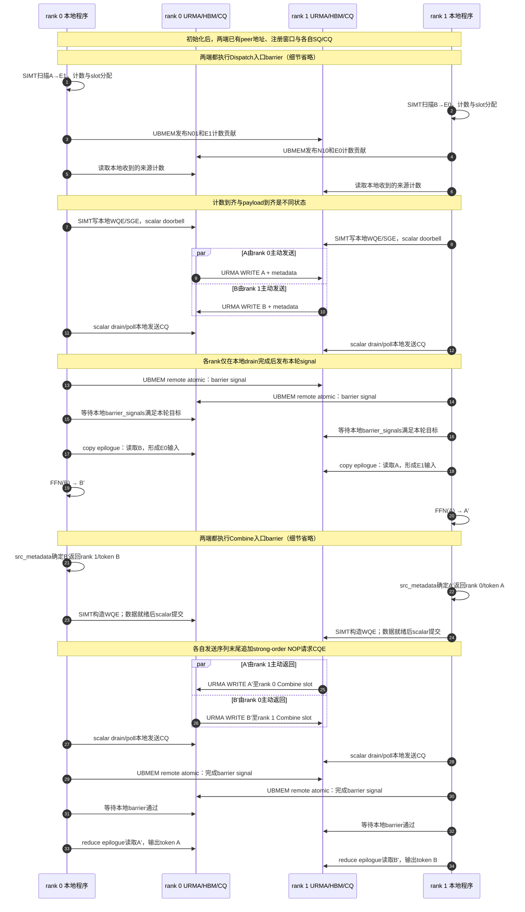
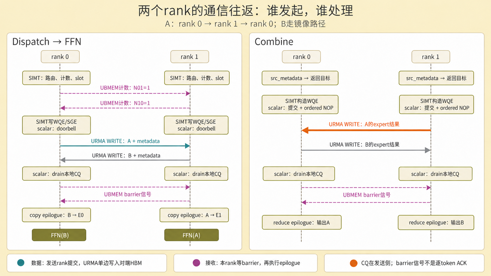

# DeepEP-Ascend SIMT 文章配图文字版规格

## 目标

这版规格用于承接文章配图重构，先确定每张图的业务目标、文案、布局、颜色和放置位置，再生成图片。

当前规划共有7张图：第1章2张、第2章2张、第3章1张、第4章1张、第5章1张。第1章和第2章只讲业务数据流；SIMT 执行方式从第3章开始引入。

## 当前状态

| 事项 | 状态 |
| --- | --- |
| 图1到图7的文字版规格 | 已完成 |
| 图1到图7的生成提示词 | 已完成 |
| 正文图片引用和图注替换 | 已完成，正文引用7张新图 |
| 新图片生成 | 已完成，均使用内置imagegen生成与编辑 |
| 旧图片清理 | 已完成，6张旧图及本地备份已删除 |
| 生成后逐图检视 | 已完成，核对案例、角色与图文衔接 |

处理节奏保持不变：先完成并确认全部文字版设计，再按章节逐张生成、替换和检视图片。

## 全局风格

- 主题：Gruvbox Light
- 画布：16:9
- 背景：浅米色 #fbf1c7
- 卡片：白色 #ffffff
- 主文字：深灰 #3c3836
- 次文字：浅灰 #665c54
- 边框：1px，浅灰 #d5c4a1
- 字体：Noto Sans SC / Inter
- 字重：Light 或 Regular，禁用 Bold
- 风格：扁平、细线、圆角、留白充足
- 不使用 3D、阴影、渐变、拟物质感

### 颜色语义

| 角色 | 颜色 | 色值 |
| --- | --- | --- |
| SIMT | 青蓝色 | #458588 |
| scalar | 紫色 | #b16286 |
| URMA | 橙色 | #d65d0e |
| MTE | 绿色 | #98971a |
| token | 黄色 | #d79921 |
| expert | 红色 | #cc241d |
| rank | 蓝紫色 | #8f3f71 |

### 禁用词

图片中不出现 WQE、SGE、SQ、CQ、queue、doorbell、Jetty、Channel、staged transport、payload、hidden、metadata。

## 参考风格

参考 CANN《AscendC高性能自定义通信编程参考实践》中第3、4、5张图的风格：三列或三段式 rank 泳道、数据流从左到右、token / expert 实例化、通信路径与计算路径分色。图形应保持浅色 Gruvbox Light 基调，卡片和连线有明确业务语义，信息密度可以较高，但阶段边界必须清楚。

## 设计节奏

1. 先按章节推进，一次只设计一张图。
2. 每张图先写清业务目标、放置位置、画面结构、全部文案、颜色语义和禁止项。
3. 文字版确认后，再生成提示词和图片。
4. 高信息密度图优先采用 HTML/CSS 或分块绘制后拼接，不直接一次性生成。
5. 图注只解释业务含义，不描述画面构图。

## 图片重排总原则

1. 先讲业务，再讲实现；图先出现在对应概念首次需要被理解的段落，而不是章节末尾。
2. 第1章先给出 MoE 业务闭环，再解释路由动态性；不把具体 token / rank 案例提前到第1章。
3. 第2章用一个与 4-rank case 完全一致的 Dispatch 数据流图和一个 Combine 数据流图承接文字表格。
4. 图注只解释业务含义，不描述画面构图，例如禁止写“左侧展示”“连线终止在”“节点颜色标明”。
5. 信息密度高的图优先采用分块绘制再拼接，或使用 HTML/CSS 布局后截图，避免直接依赖一次性图片生成。

## 图1：MoE通信的业务闭环

### 目标

用一张图回答“Router、Dispatch、Expert/FFN、Combine 分别在业务里做什么”。读者先看到 MoE 的完整业务闭环，再理解为什么需要通信。

### 放置位置

放在第1章第一段之后、Dispatch / Combine 定义之前。它应是全文第一张图，避免读者先陷入 token 到 expert 的具体映射。

### 画面结构

采用三段式横向流程，左右两个模型阶段卡片夹住中间的 MoE 通信区域：

1. 输入与路由：输入 token、Router、top-k expert 选择；
2. MoE通信与计算：Dispatch、Expert / FFN、Combine；
3. 输出：输出 token。

### 具体文案

主标题：MoE通信的业务闭环

左列卡片：

- 输入 token
- Router
- top-k expert 选择

中间区域标题：MoE Expert Parallel

Dispatch卡片：

- Dispatch
- 发送 token
- 到 expert 所在 rank

Expert卡片：

- Expert / FFN
- 分散在不同 rank
- 并行计算

Combine卡片：

- Combine
- 返回 expert 输出
- 按权重聚合

右列卡片：

- 输出 token

底部注释：Dispatch负责把token送到expert所在rank；Combine负责把expert输出送回原token并聚合成一个结果。

### 布局细节

- 画面分为三列：左侧输入与路由，中间 MoE 通信与计算，右侧输出。
- 中间区域占画面主体宽度的 55% 左右，上下留白收紧。
- Dispatch、Expert / FFN、Combine 从左到右排列，形成明确数据流。
- 连线只表达数据流，不添加装饰性箭头。
- 输入 / 输出 token 使用浅色卡片，避免与中间核心流程争夺注意力。

### 颜色语义

- 输入 token → Router：黄色 #d79921
- Router → Dispatch：蓝紫色 #8f3f71，表示路由结果驱动通信
- Dispatch → Expert / FFN：青蓝色 #458588，表示 token 发送到 expert
- Expert / FFN → Combine：橙色 #d65d0e，表示 expert 输出返回
- Combine → 输出 token：绿色 #98971a，表示聚合完成
- Router卡片：蓝紫色 #8f3f71
- Dispatch卡片：青蓝色 #458588
- Expert / FFN卡片：黄色 #d79921
- Combine卡片：橙色 #d65d0e

### 禁止项

- 不出现 token 0、rank 0、E1 等具体编号，保持业务层抽象。
- 不出现 SIMT、scalar、URMA、MTE 等实现角色。
- 不出现底层通信实现术语。
- 图注只解释业务，不描述画面构成。

### 图注

图1：MoE通信的业务闭环。Router选择expert后，Dispatch把token发送到对应rank，Expert/FFN完成计算，Combine把输出送回原token并按权重聚合。

## 图2：Router动态路由带来的通信变化

### 目标

解释为什么MoE通信计划不能在运行前固定。重点展示两个事实：

1. 同一个token在不同step可能去往不同rank；
2. 同一个step中各rank接收token数量不相等。

### 放置位置

放在第1章“通信的复杂性来自Router的动态选择”这一段之后。

### 画面结构

采用上下两个step面板：

1. 上半部分：step t；
2. 下半部分：step t+1。

每个step面板内部采用三段式：

1. 左侧token列；
2. 中间Router top-k；
3. 右侧4个rank泳道。

### 具体文案

标题：Router动态路由带来的通信变化

上方面板标题：step t

下方面板标题：step t+1

token标签：

- token 0
- token 1
- token 2
- token 3

Router标签：Router top-k

rank泳道标签：

- rank 0
- rank 1
- rank 2
- rank 3

各rank接收数量标签：

- 接收 0
- 接收 1
- 接收 2
- 接收 3

底部注释：同一个token在不同step可能去往不同rank；每个rank接收的数量也随路由变化，无法在运行前固定。

### 数据设计

step t：

| token | 目标rank |
| --- | --- |
| token 0 | rank 1、rank 2 |
| token 1 | rank 0、rank 3 |
| token 2 | rank 1 |
| token 3 | rank 2、rank 3 |

step t 各rank接收：

| rank | 接收token |
| --- | --- |
| rank 0 | token 1 |
| rank 1 | token 0、token 2 |
| rank 2 | token 0、token 3 |
| rank 3 | token 1、token 3 |

step t 接收数量：

| rank | 接收数量 |
| --- | ---: |
| rank 0 | 1 |
| rank 1 | 2 |
| rank 2 | 2 |
| rank 3 | 2 |

step t+1：

| token | 目标rank |
| --- | --- |
| token 0 | rank 0、rank 3 |
| token 1 | rank 2 |
| token 2 | rank 1、rank 3 |
| token 3 | rank 0 |

step t+1 各rank接收：

| rank | 接收token |
| --- | --- |
| rank 0 | token 0、token 3 |
| rank 1 | token 2 |
| rank 2 | token 1 |
| rank 3 | token 0、token 2 |

step t+1 接收数量：

| rank | 接收数量 |
| --- | ---: |
| rank 0 | 2 |
| rank 1 | 1 |
| rank 2 | 1 |
| rank 3 | 2 |

### 布局细节

- step t与step t+1面板之间用细分隔线，保持视觉上是同一个业务场景的两个时刻。
- token卡片使用黄色 #d79921。
- Router卡片使用蓝紫色 #8f3f71。
- rank泳道使用蓝紫色 #8f3f71 的浅色填充。
- 接收数量标签使用橙色 #d65d0e。
- step标题使用次级文字色 #665c54。

### 禁止项

- 不出现expert编号，避免读者误以为这是第2章的完整case。
- 不出现Dispatch、Combine、SIMT、scalar、URMA、MTE。
- 不出现底层通信实现术语。
- 图注只解释业务，不描述画面构成。

### 图注

图2：Router动态路由带来的通信变化。同一个token在不同step可能发送到不同rank，且每个rank接收的token数量不同，因此通信计划必须在运行时生成。

## 图3：4-rank Dispatch数据流

### 目标

用一张图把第2章的 8-token case 讲清楚：Router 结果如何变成去重后的向量发送，再如何在接收端展开为 expert 输入。重点呈现三件事：

1. 每个 token 的目标 rank；
2. 同一 token 命中同一 rank 的多个 expert 时，向量只发送一份；
3. 接收端仍按 expert 展开，最终得到 16 个 expert 输入。

### 放置位置

放在第2章 2.1 小节的路由表之后、发送关系列表之前。读者先看到表格中的精确映射，再通过这张图理解“去重前 — 去重后 — expert 输入”的转换。

### 画面结构

整体分为三个阶段，最终图片采用上下排列以容纳全部案例，依次为：

1. Router结果：8 个 token 卡片，每个卡片列出选中的 expert 和目标 rank；
2. 去重后向量：14 个向量卡片，按目标 rank 分成 4 列；
3. 接收端expert输入：16 个 expert 输入卡片，同样按目标 rank 分成 4 列。

三阶段之间用细箭头连接，表达数据从路由结果到向量发送、再到expert输入的转换。

### 具体文案

主标题：4-rank Dispatch：从Router结果到expert输入

左段标题：Router结果

token卡片文案：

- token 0：E7→rank 1，E10→rank 2
- token 1：E3→rank 0，E12→rank 3
- token 2：E5→rank 1，E8→rank 1
- token 3：E15→rank 2，E2→rank 3
- token 4：E1→rank 0，E6→rank 1
- token 5：E9→rank 2，E11→rank 2
- token 6：E4→rank 0，E14→rank 3
- token 7：E13→rank 1，E16→rank 3

中段标题：去重后向量

分组标题：

- rank 0本地
- rank 1
- rank 2
- rank 3

向量卡片文案：

- rank 0本地：token 1、token 4、token 6
- rank 1：token 0、token 2（E5+E8，一份向量）、token 4、token 7
- rank 2：token 0、token 3、token 5（E9+E11，一份向量）
- rank 3：token 1、token 3、token 6、token 7

右段标题：接收端expert输入

expert输入卡片文案：

- rank 0：token 1 / E3，token 4 / E1，token 6 / E4
- rank 1：token 0 / E7，token 2 / E5，token 2 / E8，token 4 / E6，token 7 / E13
- rank 2：token 0 / E10，token 3 / E15，token 5 / E9，token 5 / E11
- rank 3：token 1 / E12，token 3 / E2，token 6 / E14，token 7 / E16

底部摘要：

- 16个expert选择
- 14份向量：3份本地，11份远端
- 16个expert输入

### 布局细节

- 最终采用上、中、下三阶段；每阶段保留完整案例，减少窄列中的小字。
- 上阶段8个token横排，卡片内expert与目标rank用小标签表达。
- 中阶段按4个rank分列，列内展示去重后的向量。
- token 2 和 token 5 的向量卡片使用橙色徽标“一份向量”，并在卡片内列出两个 expert。
- 下阶段按4个rank分列，每个expert输入单独展示，与16个expert选择对应。
- 三段之间使用细箭头，不绘制 token 到 rank 的交叉连线，避免视觉混乱。
- 底部摘要使用三个小卡片横排，分别对应“16个expert选择”“14份向量”“16个expert输入”。

### 颜色语义

- token卡片：黄色 #d79921
- rank分组：蓝紫色 #8f3f71
- 本地向量：绿色 #98971a
- 远端向量：青蓝色 #458588
- 去重徽标：橙色 #d65d0e
- expert输入卡片：红色 #cc241d
- 主文字：深灰 #3c3836
- 次文字：浅灰 #665c54

### 禁止项

- 不出现 SIMT、scalar、URMA、MTE、slot、通信描述等实现概念。
- 不出现 WQE、SGE、SQ、CQ、queue、doorbell、Jetty、Channel、staged transport、payload、hidden、metadata。
- 不用交叉线表达 token 到 rank 的全部路径，避免画面混乱。
- 图注不描述画面构图。

### 图注

图3：4-rank Dispatch数据流。rank 0的8个token按路由结果发送到对应rank；同一token命中同一rank的多个expert时只发送一份向量，接收端再展开为多个expert输入。

## 图4：4-rank Combine数据流

### 目标

把 Combine 的 8-token case 讲成一条反向数据流：expert 输出先按来源 rank 分组，再回到原始 token，最后按 top-k 权重聚合成一个输出。重点呈现三件事：

1. 16 个 expert 输出分别来自哪个 rank；
2. 本地输出直接参与聚合，远端输出需要送回 rank 0；
3. 每个原始 token 最终只产生一个输出。

### 放置位置

放在第2章 2.2 小节的返回关系表之后、Combine 业务流程列表之前。读者先在表格中看到精确来源，再通过这张图理解“expert 输出 — 返回原始 token — 加权聚合”的完整链路。

### 画面结构

整体分为三段，从左到右依次为：

1. expert输出：16 个输出卡片，按来源 rank 分成 4 列；
2. 返回原始token：8 个 token 卡片，每个卡片列出两个 expert 输出及本地 / 远端路径；
3. token输出：8 个输出卡片，与原始 token 一一对应。

三段之间使用阶段箭头，表达从 expert 输出到返回、再到聚合输出的方向。

### 具体文案

主标题：4-rank Combine：从expert输出到token输出

左段标题：expert输出

来源分组标题：

- rank 0本地
- rank 1
- rank 2
- rank 3

expert输出卡片文案：

- rank 0本地：token 1 / E3，token 4 / E1，token 6 / E4
- rank 1：token 0 / E7，token 2 / E5，token 2 / E8，token 4 / E6，token 7 / E13
- rank 2：token 0 / E10，token 3 / E15，token 5 / E9，token 5 / E11
- rank 3：token 1 / E12，token 3 / E2，token 6 / E14，token 7 / E16

中段标题：返回原始token

token卡片文案：

- token 0：E7来自rank 1，E10来自rank 2
- token 1：E3来自rank 0，E12来自rank 3
- token 2：E5来自rank 1，E8来自rank 1
- token 3：E15来自rank 2，E2来自rank 3
- token 4：E1来自rank 0，E6来自rank 1
- token 5：E9来自rank 2，E11来自rank 2
- token 6：E4来自rank 0，E14来自rank 3
- token 7：E13来自rank 1，E16来自rank 3

路径徽标：

- 本地输出
- 远端输出
- 同一来源rank

右段标题：token输出

输出卡片文案：

- token 0输出
- token 1输出
- token 2输出
- token 3输出
- token 4输出
- token 5输出
- token 6输出
- token 7输出

聚合徽标：按top-k权重聚合

底部摘要：

- 16个expert输出
- 3个本地输出
- 13个远端输出
- 8个token输出

### 布局细节

- 左段占画面宽度约 42%，中段约 34%，右段约 24%。
- 左段最终按4个来源rank纵向分组，保持16个输出全部可见。
- rank 0本地列使用绿色强调，表示本地输出直接参与聚合。
- rank 1、rank 2、rank 3列使用蓝紫色分组，表示输出需要送回 rank 0。
- 中段按 8 个原始 token 纵向排列，每个 token 卡片内列出两个 expert 输出。
- token 2 和 token 5 使用橙色“同一来源rank”徽标，说明两个输出来自同一个 rank，但聚合时仍各自参与。
- 右段 8 个输出卡片与中段 token 一一对应，用橙色“按top-k权重聚合”徽标统一说明聚合规则。
- 三段之间只画阶段箭头，不绘制 16 条输出到 8 个 token 的交叉连线。
- 底部摘要使用四个小卡片横排，展示数量转换。

### 颜色语义

- expert输出卡片：红色 #cc241d
- rank分组：蓝紫色 #8f3f71
- 本地输出：绿色 #98971a
- 远端输出：青蓝色 #458588
- 同一来源rank徽标：橙色 #d65d0e
- token输出卡片：黄色 #d79921
- 主文字：深灰 #3c3836
- 次文字：浅灰 #665c54

### 禁止项

- 不出现 SIMT、scalar、URMA、MTE、slot、通信描述、task、reduce 等实现概念。
- 不出现 WQE、SGE、SQ、CQ、queue、doorbell、Jetty、Channel、staged transport、payload、hidden、metadata。
- 不绘制 16 条交叉连线，避免掩盖分组和聚合关系。
- 图注不描述画面构图。

### 图注

图4：4-rank Combine数据流。expert输出按来源rank返回rank 0；本地输出直接参与聚合，远端输出送回后在原始token处按top-k权重聚合。

## 图5：SIMT在MoE通信中的优势

### 目标

展示MoE通信预处理中的线程组协作与组间并行，重点呈现三件事：

1. 每个token的路由不同，需要不同分支；
2. 一个线程组协作处理一个token的top-k目标，多个线程组执行同一套路由处理程序；
3. 同一rank重复时去重，本地与远端目标分别处理。

### 放置位置

放在第3章第一段之后、SIMD与SIMT对比文字之前。先展示“组内协作、组间并行”的直观关系，再解释SIMT的通信并行粒度与三类优势。

### 画面结构

保留上方四个程序步骤和下方四行token示例，不再放置底部SIMD/SIMT特性对比卡片。保留内容在16:9画布内重新排布，避免底部留下大块空白。

四行示例从左到右展示路由结果、线程组与分支、生成的通信信息，逐行对齐。

### 具体文案

主标题：SIMT在MoE通信中的优势

程序步骤：读取路由 → 比较rank → 判断是否重复 → 生成通信信息

共享标签：SIMT：同一程序，多个线程组

| 路由结果 | 线程组 | 分支说明 | 通信信息 |
| --- | --- | --- | --- |
| token 0：rank 1、rank 2 | 线程组0 | 两个目标rank不同，两条分支 | 发送到rank 1和rank 2 |
| token 1：rank 0、rank 3 | 线程组1 | 一个本地rank，一个远端rank | 本地保留，另发送到rank 3 |
| token 2：rank 1、rank 1 | 线程组2 | 两个目标rank相同，去重后只保留一份 | 只发送一份到rank 1 |
| token 3：rank 2、rank 3 | 线程组3 | 两个目标rank不同，两条分支 | 发送到rank 2和rank 3 |

### 布局细节

- 线程组标签适当加宽，完整显示“线程组0”至“线程组3”，不换行或遮挡相邻文字。
- 四行高度和间距均衡，保留程序步骤、路由、分支说明、结果之间的对应关系。
- token 2保留橙色“去重”徽标。
- 不新增比较卡片、页脚、示例或图例，不改变四条路由和输出关系。

### 颜色语义

- token卡片：黄色 #d79921
- rank标签：蓝紫色 #8f3f71
- SIMT区域：青蓝色 #458588
- 去重徽标：橙色 #d65d0e
- 通信信息卡片：绿色 #98971a
- 主文字：深灰 #3c3836
- 次文字：浅灰 #665c54

### 禁止项

- 不出现AIV、lane、scalar、URMA、MTE、slot、通信描述等实现细节。
- 不出现WQE、SGE、SQ、CQ、queue、doorbell、Jetty、Channel、staged transport、payload、hidden、metadata。
- 不把一个token标为由单个线程独立处理，不指定线程组大小或固定warp数量。
- 不把SIMT画成单独硬件模块，只表达线程组执行同一程序的形态。
- 不恢复底部SIMD/SIMT特性卡片。
- 图注不描述画面构图。

### 图注

图5：多个线程组执行同一套路由处理程序，组内协作处理一个token的top-k目标，组间并行处理不同token。重复rank需要去重，本地与远端结果也需要不同处理。

## 图6：Dispatch的SIMT并行流程

### 目标

展示第4章 Dispatch 的整体执行方式：8个token由多个线程并行处理，同时完成读取Router结果、目标rank统计、重复rank去重、接收slot计算和通信描述构造。重点呈现四件事：

1. token路由可独立处理，线程组织为示意；统计和位置计算需要协作；
2. token 2和token 5命中重复rank，去重后只生成一份通信信息；
3. slot由本来源rank内各AIV的计数前缀与局部分配序号共同确定；
4. SIMT负责通信预处理，scalar负责提交，URMA/MTE负责数据搬运。

### 放置位置

放在第4章第一段之后、4.1小节之前。读者先看到8个token并行推进的全貌，再按小节理解每个阶段的并行特点。

### 画面结构

整体分为左侧主矩阵和右侧执行分工两个区域。

左侧主矩阵为“8行token × 5列阶段”：

1. Router结果；
2. 目标rank统计；
3. 重复rank去重；
4. 接收slot计算；
5. 通信描述构造。

右侧执行分工为三个纵向卡片：

1. scalar：提交通信描述；
2. URMA：远端数据搬运；
3. MTE：本地数据搬运。

主矩阵上方放置一个横向标签“SIMT：多个线程协作处理”，覆盖前5列，明确这些阶段由SIMT完成。

### 具体文案

主标题：Dispatch：SIMT并行处理路由信息

左侧主矩阵标题：SIMT：多个线程协作处理

列标题：

- Router结果
- 目标rank统计
- 重复rank去重
- 接收slot计算
- 通信描述构造

行标签：

- token 0
- token 1
- token 2
- token 3
- token 4
- token 5
- token 6
- token 7

各行文案：

- token 0：E7→rank 1，E10→rank 2；目标rank为1、2；无重复；rank 1 slot 0，rank 2 slot 0；生成2条通信信息
- token 1：E3→rank 0，E12→rank 3；目标rank为0、3；无重复；rank 0 slot 0，rank 3 slot 0；生成2条通信信息
- token 2：E5→rank 1，E8→rank 1；目标rank为1；重复rank去重；rank 1 slot 1；生成1条通信信息，接收端展开为2个expert输入
- token 3：E15→rank 2，E2→rank 3；目标rank为2、3；无重复；rank 2 slot 1，rank 3 slot 1；生成2条通信信息
- token 4：E1→rank 0，E6→rank 1；目标rank为0、1；无重复；rank 0 slot 1，rank 1 slot 2；生成2条通信信息
- token 5：E9→rank 2，E11→rank 2；目标rank为2；重复rank去重；rank 2 slot 2；生成1条通信信息，接收端展开为2个expert输入
- token 6：E4→rank 0，E14→rank 3；目标rank为0、3；无重复；rank 0 slot 2，rank 3 slot 2；生成2条通信信息
- token 7：E13→rank 1，E16→rank 3；目标rank为1、3；无重复；rank 1 slot 3，rank 3 slot 3；生成2条通信信息

右侧卡片文案：

- scalar：提交通信描述；维护明确提交边界
- URMA：远端数据搬运；处理11份远端向量
- MTE：本地数据搬运；处理3份本地向量

底部摘要：

- 16个expert选择
- 14条通信信息
- 3份本地向量
- 11份远端向量

底部注释：slot示例按token顺序编号，仅表示当前来源rank在各目标rank接收分区内的一组局部位置，不保证实际分配顺序。通信接收缓冲区按来源rank固定分区；其他来源rank的计数用于后续遍历与按expert展开，不决定当前来源的固定分区起点。14条通信信息是逻辑发送关系，不等于硬件描述数量。

### 布局细节

- 左侧主矩阵占画面宽度约76%，右侧执行分工占约24%。
- 5个阶段列从左到右排列，列间使用细箭头表达推进关系。
- 8个token行从上到下排列，每行左侧保留token标签。
- “Router结果”“目标rank统计”“重复rank去重”“接收slot计算”“通信描述构造”5列使用浅青蓝色背景或顶部色条，表示由SIMT完成。
- token 2和token 5的“重复rank去重”单元格使用橙色“去重”徽标，并在“通信描述构造”单元格标注“1条通信信息”。
- 其余token的去重单元格使用浅灰色“无重复”徽标。
- “接收slot计算”单元格展示具体slot值，帮助读者理解slot来自同一rank内的动态顺序。
- 右侧scalar卡片使用紫色，URMA卡片使用橙色，MTE卡片使用绿色，与左侧SIMT区域形成明确分工。
- 底部摘要使用四个小卡片横排，保持数量关系一眼可见。
- 不绘制token到rank的交叉连线，矩阵行本身表达每个token的独立处理过程。

### 颜色语义

- SIMT阶段：青蓝色 #458588
- token标签：黄色 #d79921
- rank标签：蓝紫色 #8f3f71
- 去重徽标：橙色 #d65d0e
- 通信信息：绿色 #98971a
- scalar：紫色 #b16286
- URMA：橙色 #d65d0e
- MTE：绿色 #98971a
- 主文字：深灰 #3c3836
- 次文字：浅灰 #665c54

### 禁止项

- 不出现AIV、lane、WQE、SGE、SQ、CQ、queue、doorbell、Jetty、Channel、staged transport、payload、hidden、metadata。
- 不把scalar、URMA、MTE画成SIMT的一部分；它们只作为后续执行分工出现。
- 不绘制复杂交叉连线，避免破坏矩阵的可读性。
- 不使用长句填充单元格；每格只保留阶段结果和必要徽标。
- 图注不描述画面构图。

### 图注

图6：Dispatch的SIMT并行流程。8个token并行处理路由，去重后形成14份向量关系。slot只示意局部顺序，硬件描述数量取决于实际实现；scalar维护提交边界，URMA和MTE分别负责远端与本地搬运。

## 图7：Combine的SIMT流水线

### 目标

展示通信准备与数据归约如何协作，明确SIMT、SIMD、scalar和URMA的分工。沿用第2章的返回数量，但将业务来源分组与实际内核task区分开。

### 放置位置

放在第5章第一段之后、5.1小节之前。先展示返回关系和双轨流水线，再解释各阶段。

### 画面结构

保留左侧来源分组、右侧双轨流水线和底部数量摘要的布局。

左侧展示rank 0这8个token的结果来源，标题为“结果来源（业务视角）”：

- rank 1 / 5个expert输出
- rank 2 / 4个expert输出
- rank 3 / 4个expert输出
- rank 0本地 / 3个expert输出

这些是业务分组，不直接标为4个内核task。各发送rank按原始token所在的目标rank和批次组织task；实际task数量还取决于token数量和执行单元划分。

右侧展示“各发送rank内的流水线”：

- 上轨：通信准备 / SIMT。读取返回信息 → 计算token返回位置 → 构造通信描述。
- 下轨：数据处理 / SIMD + MTE。读取expert输出 → 同一token局部归约 → 保存待返回结果。

数据和描述准备就绪后，再进入“scalar提交 → URMA远端写回”。提交通信描述不放在SIMT轨道内。本地结果直接留在本地，不进入URMA路径。

### 流水线文案

- 同一时间窗
- 当前task：数据归约
- 下一task：信息已准备

这里的task是同一发送rank内的相邻任务，不把它们固定对应为来自rank 1或rank 2的分组。状态条说明预先解析下一任务的返回信息，并不承诺SIMT与SIMD在同一执行资源上同时执行。

### 最终聚合文案

rank 0等待所需结果到齐，再按原始token聚合并写回输出。

本地路径说明：本地结果不经远端写回，直接参与最终聚合。

数量摘要：

- 16个expert输出
- 3个本地输出
- 13个远端输出
- 8个token输出

13个远端expert输出不是13次传输。同一rank内属于同一token的多个输出可以先做局部归约。

### 风格与颜色

沿用全局Gruvbox Light风格，不改变配色、字体、圆角或细线要求。SIMT为青蓝色，来源rank为蓝紫色，本地结果为绿色，数据归约为橙色，scalar提交为紫色。阶段边界清楚，不使用交叉连线。

### 禁止项

- 不把SIMD局部归约标为SIMT。
- 不把scalar提交标为SIMT。
- 不把rank 0已收到的结果重新画成由rank 0远端发送。
- 不把4个业务来源分组当作实际固定task数量。
- 不出现AIV、lane以及全局禁用的底层通信术语。
- 本地结果不得连接远端写回路径。
- 图注只解释业务和执行分工，不描述构图。

### 图注

图7：Combine将SIMT返回信息解析与SIMD局部归约组成流水线，数据和描述准备就绪后由scalar提交远端传输；本地结果直接保留，最终在原始token所在rank聚合。

### 准确性依据

核对官方[Combine实现](https://github.com/deepseek-ai/DeepEP-Ascend/blob/main/deep_ep/include/deep_ep/impls/ep/combine.hpp)及[归约实现](https://github.com/deepseek-ai/DeepEP-Ascend/blob/main/deep_ep/include/deep_ep/impls/ep/combine_utils.hpp)：SIMT构造描述，SIMD处理向量归约，scalar在依赖满足后提交。CANN参考报告仅用作视觉参考，不将其实现细节直接套入本文。

## 图片放置原则

| 图 | 主题 | 建议位置 | 原因 |
| --- | --- | --- | --- |
| 图1 | MoE通信的业务闭环 | 第1章第一段后 | 先建立业务闭环，再进入动态路由 |
| 图2 | Router动态路由带来的通信变化 | 第1章动态选择段后 | 直观说明通信计划必须运行时生成 |
| 图3 | 4-rank Dispatch数据流 | 第2章路由表后 | 将8-token case从路由结果讲到expert输入 |
| 图4 | 4-rank Combine数据流 | 第2章返回关系表后 | 将8-token case从expert输出讲到token输出 |
| 图5 | SIMT在MoE通信中的优势 | 第3章开头 | 先展示线程组协作与组间并行，再解释适配原因 |
| 图6 | Dispatch的SIMT并行流程 | 第4章开头 | 先看并行处理方式，再拆阶段讲 |
| 图7 | Combine的SIMT流水线 | 第5章开头 | 先看流水线，再讲task和重叠 |

## 生成提示词

### 图1提示词

Use case: infographic-diagram
Asset type: first figure of a Chinese technical article for readers new to communication.
Create a production-ready flat 16:9 landscape infographic, title exactly "MoE通信的业务闭环". Gruvbox Light palette: solid cream #fbf1c7 background, white rounded cards, thin #d5c4a1 borders, dark grey #3c3836 text. Noto Sans SC / Inter REGULAR/light typography, including title; no bold, texture, gradient, shadows, 3D, icons or watermark.
Composition: compact top title with 5% top margin, main flow fills middle 60% height, short business explanation at bottom with 5% bottom margin. Avoid large empty bands. Six equal-height cards in a single horizontal connected sequence:
"输入 token" → "Router" with "top-k expert 选择" → "Dispatch" with "发送 token" and "到 expert 所在 rank" → "Expert / FFN" with "分散在不同 rank" and "并行计算" → "Combine" with "返回 expert 输出" and "按权重聚合" → "输出 token".
Group exactly Dispatch, Expert / FFN, Combine in an enclosing rounded area headed "MoE Expert Parallel".
Router accent purple #8f3f71, Dispatch teal #458588, Expert mustard #d79921, Combine orange #d65d0e, output olive #98971a. Thin directional arrows only between immediate neighbours, with sensible colored accents.
Footer exactly "Dispatch把token送到expert所在rank；Combine把expert输出送回并按权重聚合。"
All text must be verbatim readable Chinese and English. No specific token/rank/expert numbers and no implementation details.

### 图2提示词

Create a flat, clean 16:9 technical infographic titled “Router动态路由带来的通信变化”. Use the same Gruvbox Light style, white rounded cards, thin borders, and no bold text.

Create two stacked step panels, “step t” above and “step t+1” below. Each panel contains four token cards on the left, one Router card in the middle, and four rank lanes on the right. Render these exact mappings:

step t:

- token 0 → rank 1、rank 2
- token 1 → rank 0、rank 3
- token 2 → rank 1
- token 3 → rank 2、rank 3

step t rank counts:

- rank 0 接收 1
- rank 1 接收 2
- rank 2 接收 2
- rank 3 接收 2

step t+1:

- token 0 → rank 0、rank 3
- token 1 → rank 2
- token 2 → rank 1、rank 3
- token 3 → rank 0

step t+1 rank counts:

- rank 0 接收 2
- rank 1 接收 1
- rank 2 接收 1
- rank 3 接收 2

Use token #d79921, Router #8f3f71, rank lanes #8f3f71 with light fill, and receiving-count badges #d65d0e. Do not show expert IDs, Dispatch, Combine, SIMT, scalar, URMA, or MTE.

### 图3提示词

Create a high-density but readable flat 16:9 infographic titled “4-rank Dispatch：从Router结果到expert输入”. Use the same Gruvbox Light style, white rounded cards, thin borders, and no bold text.

Use three horizontal sections separated by thin arrows: “Router结果”, “去重后向量”, and “接收端expert输入”.

Render the Router results exactly:

- token 0：E7→rank 1，E10→rank 2
- token 1：E3→rank 0，E12→rank 3
- token 2：E5→rank 1，E8→rank 1
- token 3：E15→rank 2，E2→rank 3
- token 4：E1→rank 0，E6→rank 1
- token 5：E9→rank 2，E11→rank 2
- token 6：E4→rank 0，E14→rank 3
- token 7：E13→rank 1，E16→rank 3

Render the deduplicated vectors by rank:

- rank 0本地：token 1、token 4、token 6
- rank 1：token 0、token 2（E5+E8，一份向量）、token 4、token 7
- rank 2：token 0、token 3、token 5（E9+E11，一份向量）
- rank 3：token 1、token 3、token 6、token 7

Render the receiving expert inputs:

- rank 0：token 1 / E3，token 4 / E1，token 6 / E4
- rank 1：token 0 / E7，token 2 / E5，token 2 / E8，token 4 / E6，token 7 / E13
- rank 2：token 0 / E10，token 3 / E15，token 5 / E9，token 5 / E11
- rank 3：token 1 / E12，token 3 / E2，token 6 / E14，token 7 / E16

Add three summary cards: “16个expert选择”, “14份向量：3份本地，11份远端”, “16个expert输入”. Use token #d79921, rank #8f3f71, local #98971a, remote #458588, deduplication badges #d65d0e, expert inputs #cc241d. Do not draw all token-to-rank crossing lines; organize by rank lanes.

### 图4提示词

Create a high-density but readable flat 16:9 infographic titled “4-rank Combine：从expert输出到token输出”. Use the same Gruvbox Light style, white rounded cards, thin borders, and no bold text.

Use three sections from left to right: “expert输出”, “返回原始token”, and “token输出”.

Render the expert outputs grouped by source:

- rank 0本地：token 1 / E3，token 4 / E1，token 6 / E4
- rank 1：token 0 / E7，token 2 / E5，token 2 / E8，token 4 / E6，token 7 / E13
- rank 2：token 0 / E10，token 3 / E15，token 5 / E9，token 5 / E11
- rank 3：token 1 / E12，token 3 / E2，token 6 / E14，token 7 / E16

Render the return relationships:

- token 0：E7来自rank 1，E10来自rank 2
- token 1：E3来自rank 0，E12来自rank 3
- token 2：E5来自rank 1，E8来自rank 1
- token 3：E15来自rank 2，E2来自rank 3
- token 4：E1来自rank 0，E6来自rank 1
- token 5：E9来自rank 2，E11来自rank 2
- token 6：E4来自rank 0，E14来自rank 3
- token 7：E13来自rank 1，E16来自rank 3

Render eight cards “token 0输出” through “token 7输出”, each labeled “按top-k权重聚合”. Add summary cards: “16个expert输出”, “3个本地输出”, “13个远端输出”, “8个token输出”. Use expert outputs #cc241d, rank #8f3f71, local #98971a, remote #458588, aggregation badges #d65d0e, token outputs #d79921. Do not draw 16 crossing lines.

### 图5提示词

Create a flat, clean 16:9 infographic titled exactly “SIMT在MoE通信中的优势”. Use the approved Gruvbox Light style: solid cream #fbf1c7 background, white #ffffff rounded cards, thin #d5c4a1 borders, dark #3c3836 text, Noto Sans SC / Inter regular/light typography including title. No bold, gradients, shadows, texture, 3D or watermark.

Place four shared program steps above the example rows: “读取路由” → “比较rank” → “判断是否重复” → “生成通信信息”. Shared label exactly “SIMT：同一程序，多个线程组”.

Create four aligned rows showing these exact transformations:

- token 0：rank 1、rank 2 → 线程组0 / token 0：两个目标rank不同，两条分支 → 发送到rank 1和rank 2
- token 1：rank 0、rank 3 → 线程组1 / token 1：一个本地rank，一个远端rank → 本地保留，另发送到rank 3
- token 2：rank 1、rank 1 → 线程组2 / token 2：两个目标rank相同，去重后只保留一份 → 只发送一份到rank 1
- token 3：rank 2、rank 3 → 线程组3 / token 3：两个目标rank不同，两条分支 → 发送到rank 2和rank 3

Add an orange “去重” badge on token 2. Widen thread-group labels just enough to fit without wrapping or overlap. Do not specify a thread count, warp size or fixed group size. Each group cooperates on one token; groups process different tokens in parallel.

Do not include bottom SIMD/SIMT feature comparison cards or any new footer, legend or example. Fill the canvas with the program steps and four-row region using balanced spacing and compact aligned cards, without a large blank bottom band.

Use token #d79921, rank #8f3f71, SIMT #458588, dedup badge #d65d0e, communication information #98971a. Do not show AIV, lane, scalar, URMA, MTE, slot, or communication descriptors.

### 图6提示词

Create a high-density flat 16:9 infographic titled “Dispatch：SIMT并行处理路由信息”. Use the same Gruvbox Light style, white rounded cards, thin borders, and no bold text.

Create an 8-row by 5-stage matrix. The header above the matrix must say “SIMT：多个线程协作处理”. Column headers are “Router结果”, “目标rank统计”, “重复rank去重”, “接收slot计算”, “通信描述构造”.

Render the exact rows:

- token 0：E7→rank 1，E10→rank 2；目标rank 1、2；无重复；rank 1 slot 0，rank 2 slot 0；生成2条通信信息
- token 1：E3→rank 0，E12→rank 3；目标rank 0、3；无重复；rank 0 slot 0，rank 3 slot 0；生成2条通信信息
- token 2：E5→rank 1，E8→rank 1；目标rank 1；去重；rank 1 slot 1；生成1条通信信息，接收端展开为2个expert输入
- token 3：E15→rank 2，E2→rank 3；目标rank 2、3；无重复；rank 2 slot 1，rank 3 slot 1；生成2条通信信息
- token 4：E1→rank 0，E6→rank 1；目标rank 0、1；无重复；rank 0 slot 1，rank 1 slot 2；生成2条通信信息
- token 5：E9→rank 2，E11→rank 2；目标rank 2；去重；rank 2 slot 2；生成1条通信信息，接收端展开为2个expert输入
- token 6：E4→rank 0，E14→rank 3；目标rank 0、3；无重复；rank 0 slot 2，rank 3 slot 2；生成2条通信信息
- token 7：E13→rank 1，E16→rank 3；目标rank 1、3；无重复；rank 1 slot 3，rank 3 slot 3；生成2条通信信息

On the right, add three role cards:

- scalar：提交通信描述 / 维护明确提交边界
- URMA：远端数据搬运 / 处理11份远端向量
- MTE：本地数据搬运 / 处理3份本地向量

Add four summary cards: “16个expert选择”, “14条通信信息”, “3份本地向量”, “11份远端向量”. Use SIMT #458588, scalar #b16286, URMA #d65d0e, MTE #98971a. Do not draw crossing token-to-rank lines and do not show AIV or lane.
Global approved style: 16:9, Gruvbox Light. Solid cream #fbf1c7, white cards #ffffff, dark text #3c3836, secondary #665c54, hairline borders #d5c4a1, Noto Sans SC / Inter Light or Regular ONLY including title. Flat rounded cards, no bold, gradient, shadow, texture or 3D. SIMT #458588, scalar #b16286, URMA #d65d0e, MTE #98971a, token #d79921, expert #cc241d, rank #8f3f71.
Use exactly 8 token rows, without merging, omitting or duplicating any. This is a pedagogical matrix, not a hardware memory layout. Add the small footer note "slot为局部示例；14条为逻辑通信信息，非硬件描述数量". Column 2 shows per-token target ranks. Add one slim aggregate row under the matrix: "去重后数量：rank 0 = 3，rank 1 = 4，rank 2 = 3，rank 3 = 4". Keep scalar OUTSIDE SIMT area, and fork its submission arrow to URMA and MTE, not URMA→MTE. No per-cell miniature arrows. Exact text and numbers matter more than decoration.

### 图7提示词

Use case: infographic-diagram
Asset type: figure 7 of the same Chinese technical article, a precise Combine pipeline.
Global approved style: 16:9, Gruvbox Light. Solid cream #fbf1c7, white cards #ffffff, dark text #3c3836, secondary #665c54, hairline borders #d5c4a1, Noto Sans SC / Inter Light or Regular ONLY including title. Flat rounded cards, no bold, gradient, shadow, texture or 3D. SIMT #458588, scalar #b16286, URMA #d65d0e, MTE #98971a, token #d79921, expert #cc241d, rank #8f3f71.
Title exactly "Combine：SIMT流水线解析返回信息", medium regular font, compact margins. Keep 16:9, readable text, no complex crossing wires.

LEFT 22%: an area headed "结果来源（业务视角）", four stacked cards:
"rank 1" / "5个expert输出"
"rank 2" / "4个expert输出"
"rank 3" / "4个expert输出"
"rank 0本地" / "3个expert输出".
Remote cards use rank-purple outlines; local card olive. Under these cards a short note "业务分组 ≠ 内核task数量". These counts refer to the rank 0 case, NOT four actual scheduled tasks.

RIGHT 78%, two tracks enclosed in an area headed "各发送rank内的流水线":
UPPER teal track label "通信准备 / SIMT", exactly three nodes connected left to right:
"读取返回信息" → "计算token返回位置" → "构造通信描述".
LOWER orange track label "数据处理 / SIMD + MTE", exactly three nodes connected left to right:
"读取expert输出" → "同一token局部归约" → "保存待返回结果".
The lower track is NOT labelled SIMT. This local reduction can happen on a remote sender as well; it means computation local to that sender, not rank 0 final aggregation.

After both tracks have produced prepared data and descriptions, a thin junction leads to a SEPARATE purple card "scalar提交", then separate orange card "URMA远端写回". Do not submit before data is ready. These cards must be outside SIMT area and not absorbed into the SIMT track. The rank 0 local result bypasses URMA.

Below the tracks, a compact aligned two-row pipeline window headed "流水线示意":
"当前task：数据归约"
"下一task：信息已准备"
Make the temporal relationship clear using short parallel colored bars; never imply final token output before required remote results arrive.

One bottom full-width business strip:
"rank 0：所需结果到齐 → 按原始token聚合 → 写回8个token输出".
Beside it a green local-path note exactly "本地结果不经远端写回，直接参与最终聚合". Keep this local path separate from the remote URMA path.

Bottom summary badges exactly:
"16个expert输出" / "3个本地输出" / "13个远端输出" / "8个token输出".

Constraints: readable precise text, no duplicated nodes, no made-up labels. No AIV, lane, WQE, SGE, SQ, CQ, queue, doorbell, Jetty, Channel, payload, hidden, metadata. Do not label SIMD reduction or scalar submission as SIMT. Do not assign task i to a hard-coded source rank. 13 remote expert outputs are logical contributions, not necessarily 13 transmissions.

## 最终资产与验收记录

完成日期：2026-10-14。执行方式：当前会话直接调用内置imagegen，逐张生成、查看，再进行局部编辑。最终图片没有使用Pillow覆盖文字或代码绘制；原历史渲染脚本仅保留为归档工具。

最终检查：7张PNG均为1672×941（约16:9），图像数据完整可解码；正文图号1到7顺序正确，章节分布为1/1/2/2/3/4/5；全部本地图片与文档链接有效。路由表推导的向量数量为3/4/3/4，expert输出数量为3/5/4/4；git diff --check通过。

| 图 | 最终资产 | 重点核对 |
| --- | --- | --- |
| 图1 | [deepep-ascend-simt-moe-business-loop.png](../ascend-assets/deepep-ascend-simt-moe-business-loop.png) | MoE业务闭环、标题和输入输出 |
| 图2 | [deepep-ascend-simt-router-dynamic-flow.png](../ascend-assets/deepep-ascend-simt-router-dynamic-flow.png) | 两步路由、接收token和计数 |
| 图3 | [deepep-ascend-simt-dispatch-case.png](../ascend-assets/deepep-ascend-simt-dispatch-case.png) | 8条路由、14份向量、16个expert输入 |
| 图4 | [deepep-ascend-simt-combine-case.png](../ascend-assets/deepep-ascend-simt-combine-case.png) | 16个expert输出、3本地、13远端、8输出 |
| 图5 | [deepep-ascend-simt-parallel-routing.png](../ascend-assets/deepep-ascend-simt-parallel-routing.png) | 4条示例路由、线程组协作、重复rank去重；已移除底部特性对比 |
| 图6 | [deepep-ascend-simt-dispatch-parallel-flow.png](../ascend-assets/deepep-ascend-simt-dispatch-parallel-flow.png) | 8行5阶段、slot、token 2/5去重、提交与搬运分工 |
| 图7 | [deepep-ascend-simt-combine-pipeline.png](../ascend-assets/deepep-ascend-simt-combine-pipeline.png) | 来源分组、SIMT/SIMD/scalar分工、本地绕过远端传输 |

正文已按图1到图7顺序引用全部新图，图前过渡、图注及阶段标题同步调整。高密度Dispatch数据流最终采用上下三阶段，以完整保留案例标签。

6张未再被文档引用的旧图及其本地备份已删除；旧图可从Git历史恢复，其他文章的图片保留。历史脚本默认输出改到 `.scratch/imagegen/legacy-renderer/`，避免再次产生过时正文资产。规格文件已更名为不含版本号的文件名。

### 最终局部修订提示词

以下为生成后按原规格实施的局部修订，配合上面的逐图生成提示词使用。只修正字重、配色、可读性或数据错误，不另设视觉风格。

#### 图1局部修订

Edit the supplied infographic to meet the already approved style specification exactly. Keep all business labels, the six-card horizontal sequence, all grouping and arrows unchanged. Change ONLY visual styling: make background a completely flat solid #fbf1c7 (no gradient, texture, glow); white cards completely flat #ffffff; thin 1px #d5c4a1 borders. Every text including title must be Noto Sans SC / Inter REGULAR or LIGHT, absolutely no bold. Reduce title font size to about 46px on a 1680px wide canvas. Use consistent simple flat geometry with no shadows. Change the final Combine→输出 token arrow to olive #98971a. Keep readable Chinese verbatim. No added text or elements. Preserve 16:9. This is Gruvbox Light technical documentation style, flat, fine-line, rounded cards.

#### 图2局部修订

Targeted correction to the supplied candidate: preserve the two stacked panels and three-zone structure. Use the approved flat style exactly: background #fbf1c7, white cards, thin colored outlines, all title and labels Regular/light, no gradients or shadows. Do NOT leave mappings implicit in wires passing through Router.
In EACH left token card add its exact destination ranks below its token name:
step t: token 0 "→ rank 1、2"; token 1 "→ rank 0、3"; token 2 "→ rank 1"; token 3 "→ rank 2、3".
step t+1: token 0 "→ rank 0、3"; token 1 "→ rank 2"; token 2 "→ rank 1、3"; token 3 "→ rank 0".
In EACH right rank card add the exact received tokens:
step t: rank 0 "token 1"; rank 1 "token 0、2"; rank 2 "token 0、3"; rank 3 "token 1、3".
step t+1: rank 0 "token 0、3"; rank 1 "token 2"; rank 2 "token 1"; rank 3 "token 0、2".
Keep all orange count badges EXACTLY as specified. Center cards say "Router top-k". Arrows can be grouped so they do not obscure text. Header dark gray #3c3836 regular, not purple bold. Exact readable labels, no extra text.

#### 图3局部修订

Use case: precise-object-edit
Change ONLY the color styling of the supplied accurate Dispatch infographic to the already approved Gruvbox Light palette. Preserve ALL text, ALL 8 token mappings, ALL 14 deduplicated vectors, ALL 16 expert inputs, ALL summary counts, all arrows and all positions. Do not redraw, reflow or rearrange the layout.
Replace the pale near-white outer background with flat solid cream #fbf1c7. Main panel interiors and cards white #ffffff. Exterior borders thin #d5c4a1 instead of heavy black. Main title regular weight, dark #3c3836. Preserve mustard token accents #d79921, purple ranks #8f3f71, teal remote accents #458588, olive local #98971a, orange deduplication #d65d0e, red expert #cc241d. All fills should be flat, no gradients/shadows/texture. All letters and numbers are immutable; especially token 2 E5/E8 and token 5 E9/E11, rank counts 3/4/3/4, and total 16→14→16.

#### 图4局部修订

Use case: precise-object-edit
Change ONLY color styling of this accurate Combine infographic to the approved Gruvbox Light palette. Preserve ALL 16 expert cards, ALL 8 return rows, ALL 8 output rows, every label, number, arrow and position. Do not redraw or rearrange anything.
Replace the near-white outer background with flat solid cream #fbf1c7. Main panels and cards white #ffffff. All borders hairline #d5c4a1; title regular/light #3c3836, not bold. Use muted purple #8f3f71 for rank groups, olive #98971a for local, teal #458588 for remote, orange #d65d0e for aggregation, mustard #d79921 for token output, red #cc241d for expert. No gradient/shadow/texture.
Data invariants: rank 0 token 1/E3,4/E1,6/E4; rank 1 token 0/E7,2/E5,2/E8,4/E6,7/E13; rank 2 token 0/E10,3/E15,5/E9,5/E11; rank 3 token 1/E12,3/E2,6/E14,7/E16. Counts 16 expert outputs, 3 local, 13 remote, 8 token outputs. Preserve every return relationship.

#### 图5局部修订（2026-10-19，以此版为准）

Use case: precise-object-edit
Edit target: the supplied existing Gruvbox Light infographic. Apply ONLY the following user-approved changes. Preserve all 4 token/rank mappings, conditional explanations, arrows, icons, semantic colors, regular/light typography, cream background and rounded white card style.

1. Replace title with exactly "SIMT在MoE通信中的优势".
2. REMOVE the entire bottom comparison section: both the SIMD card and the SIMT card, including their icons and all their feature text. There must be NO SIMD/SIMT feature comparison cards anywhere in the resulting image.
3. Keep the upper four program-step cards exactly "读取路由" → "比较rank" → "判断是否重复" → "生成通信信息".
4. Replace the little shared label with exactly "SIMT：同一程序，多个线程组".
5. Replace the four narrow labels "线程0", "线程1", "线程2", "线程3" with exactly "线程组0", "线程组1", "线程组2", "线程组3". Widen those label cards just enough to fit without wrapping or overlap. Do NOT specify thread counts, warp size or any fixed group size.
6. Keep all four example rows exactly:
token 0: rank 1、rank 2 → 线程组0 → "token 0：两个目标rank不同，两条分支" → "发送到 rank 1 和 rank 2".
token 1: rank 0、rank 3 → 线程组1 → "token 1：一个本地rank，一个远端rank" → "本地保留，另发送到 rank 3".
token 2: rank 1、rank 1 → 线程组2 → "token 2：两个目标rank相同，去重后只保留一份" with orange "去重" badge → "只发送一份到 rank 1".
token 3: rank 2、rank 3 → 线程组3 → "token 3：两个目标rank不同，两条分支" → "发送到 rank 2 和 rank 3".
7. Retain a 16:9 landscape canvas. Reflow ONLY the retained upper content to fill the available height neatly: enlarge the four-row region and use balanced spacing, without leaving the large blank area where the bottom cards were removed. Keep all rows aligned and compact. No new sections, footers, examples, legends, decoration or text.

Color/style invariants: flat #fbf1c7 background, white #ffffff cards, thin #d5c4a1 borders, regular/light Noto Sans SC/Inter, dark #3c3836 text, mustard tokens, purple rank chips, teal SIMT accents, orange dedup badge, green output accents. No bold, shadows, gradients, 3D or watermark.

#### 图6局部修订

Use case: precise-object-edit
Edit the supplied 8-row Dispatch matrix. Preserve all eight row labels, all expert/rank mappings, ALL slot values, all counts, role cards, layout and arrows exactly.
ONE critical data correction: in row "token 2", final column "通信描述构造", change "生成2条通信信息" to exactly "生成1条通信信息". Keep its second line "接收端展开为2个expert输入". Row "token 5" already correctly has "生成1条通信信息"; preserve it.
Put the word "去重" in an orange #d65d0e small badge in the token 2 and token 5 third-stage cells, without changing any adjacent text.
Make title "Dispatch：SIMT并行处理路由信息" regular/light typography, not bold. Make all fills flat (no gradients); maintain the approved Gruvbox Light #fbf1c7 background, white cards, #d5c4a1 thin borders. Do not add, remove, reorder, duplicate or alter any token row. Exact data accuracy is critical.

#### 图7局部修订

Use case: precise-object-edit
Apply ONLY the approved Gruvbox Light visual style to this accurate Combine diagram. Preserve EVERY label, number, arrow, track, pipeline bar, source card, local bypass and placement exactly. No content edits.
Set title and ALL section headers to REGULAR or LIGHT sans-serif weight. No bold anywhere. Use flat solid #fbf1c7 background, white #ffffff cards, thin #d5c4a1 exterior borders, and the existing muted Gruvbox teal/purple/olive/orange accents. Remove gradients or texture while preserving pale flat track colors. Keep all text readable, no text omissions, no duplicate nodes. This is a typography and flat-color correction only.

### 实现与口径校验

- 同一token的重复目标rank去重，只减少向量发送，expert输入仍需展开。
- 第2章数量仅来自rank 0的8个token；其他来源rank的计数不在图中。
- slot是局部顺序示例，14条通信信息是逻辑发送关系，不保证相同硬件描述数量。
- Combine数值归约使用SIMD，SIMT解析返回信息并构造描述；scalar提交属于单独边界。
- 结果来源分组不是实际固定task数量；发送端按原始token所在的返回目标划分批次。
- 权重聚合是模型业务；权重可以提前应用，Combine归约已加权结果。
- 性能表核对[官方README](https://github.com/deepseek-ai/DeepEP-Ascend#performance)，排除最终后处理，不作为SIMT相对SIMD的独立加速比。

## 2026-10-19定向修订记录

本次只实施用户敲定的7项优化：第3章标题、线程组表述与通信并行粒度补充，通信预处理术语，一分钟概览，以及Combine流水执行段落的适度压缩。正文保留task交错执行、各执行单元分工及局部归约与最终聚合的区别，并检查前后衔接。

图片仍使用内置imagegen，延续Gruvbox Light既定风格，覆盖原资产路径：图5删除底部特性卡片、改为线程组；图6只替换主标题与SIMT横幅；图7只替换主标题。图1—4、案例数据与本文件后续“两rank内部分析”均不改动。上方逐图规格与生成提示词已同步为当前版本。

### 图6本次实际编辑提示词

Use case: text-localization
Edit ONLY TWO text areas in the supplied existing Dispatch matrix. Everything else is immutable.
1. Replace the main title "Dispatch：SIMT并行整理通信信息" with exactly "Dispatch：SIMT并行处理路由信息".
2. Replace the teal banner "SIMT：多个线程同时整理" with exactly "SIMT：多个线程协作处理".

Preserve all other pixels and composition as closely as possible: all E IDs, rank IDs, all 8 token rows, 5 stage headers, every slot, every number, every badge, all scalar/URMA/MTE cards and arrows, summary counts and footer. Do not reflow the matrix, add/delete/reorder/duplicate rows, or revise wording elsewhere.
Critical invariants: token 2 and token 5 both generate 1 communication information entry, both have dedup orange badges; all other tokens generate 2. Counts remain 16,14,3,11. The per-rank count footer remains rank 0=3,rank 1=4,rank 2=3,rank 3=4.
Keep exact Gruvbox Light palette and flat style, light/regular fonts (including the new title), original 16:9 landscape. No new labels, no new effects, no new color choices.

### 图7本次实际编辑提示词

Use case: text-localization
In the supplied existing Combine infographic, change ONLY the main title from "Combine：SIMT流水线整理返回结果" to exactly "Combine：SIMT流水线解析返回信息".

All other contents and geometry are immutable: preserve the source-rank cards (rank 1:5, rank 2:4, rank 3:4, rank 0 local:3), the SIMT and SIMD+MTE tracks, scalar/URMA cards, every arrow, the local bypass, the entire pipeline illustration, footer and all 16/3/13/8 counts. Do not remove, add, reorder or rename any node, step or timeline bar.
Preserve regular/light font weight, exact existing Gruvbox Light color palette and flat styling. Keep 16:9. Fit the new title naturally on the same top line. Do not alter any other text or introduce gradients, shadows, icons or decoration.

## 内部分析：两个rank的通信往返与主动方

日期：2026-10-15。用途：个人学习与协议分析，不加入软文正文，也不改变正文7张图的编号。本节允许WQE、SGE、SQ、CQ、CQE、doorbell、Jetty、UBMEM、metadata等通信术语；前文的软文禁用词不适用于本节。视觉仍沿用Gruvbox Light。

### 实现基线与分析范围

沿用软文所引用的官方DeepEP-Ascend，固定源码版本为 `3b25377d04b24fc6154698ded78a2bcb2c59afff`。这里分析非cached、expanded Dispatch/Combine；将完成等待放在epilogue，即 `barrier_in_prologue=false`。初始化、Host计数同步及deferred epilogue只说明作用，不展开额外分支。

本目录fork的 `csrc/backends/ascend/` 还包含其他transport/service协议，本节不将这些路径的控制标志混入官方直接构造并提交WQE的流程。

### 核心答案：相同代码怎样既发送又接收

每个rank维护自己的输入、通信窗口、workspace、Jetty/SQ/CQ，以及本地expert输入输出。相同代码的参数 `rank_idx` 和本地路由、地址、返回metadata不同，因此“发给其他rank”和“处理其他rank发来的数据”分别作用于本rank的发送列表和接收窗口。

这条实现的数据面是URMA单边远端写。发送rank的AIV构造并提交WQE，URMA硬件读取发送侧数据并写入目标rank已注册的HBM窗口。目标rank的AIV无需针对每个WRITE调用post-recv，也不需要被远端调用或回调唤醒。对端内存被硬件写入，可以与本rank准备或提交自己的发送并行进行。

接收后的计算由本rank自己调度：先完成本地发送CQ drain并参与跨rank barrier，再执行copy/reduce epilogue处理已接收的数据。因此，“同一个rank兼任发送和接收”指同一轮集合操作中的双重角色，并不要求一个SIMT线程在同一时刻同时执行发送和接收代码。[发送描述与提交](https://github.com/deepseek-ai/DeepEP-Ascend/blob/3b25377d04b24fc6154698ded78a2bcb2c59afff/deep_ep/include/deep_ep/impls/ep/dispatch.hpp#L327)、[本地CQ与barrier](https://github.com/deepseek-ai/DeepEP-Ascend/blob/3b25377d04b24fc6154698ded78a2bcb2c59afff/deep_ep/include/deep_ep/comm/barrier.hpp#L112)。

### 两rank示例与符号

只设两个rank，top-k=1：

| 对象 | 原始rank | 被选expert | expert所在rank | 完整业务方向 |
| --- | --- | --- | --- | --- |
| token A | rank 0 | E1 | rank 1 | rank 0 → rank 1计算 → rank 0输出 |
| token B | rank 1 | E0 | rank 0 | rank 1 → rank 0计算 → rank 1输出 |

A是主要跟踪对象，B说明另一rank同时执行的镜像工作。两者没有本地expert命中，因此示例没有本地保留的数据路径；若出现本地命中，则通过本地MTE复制或归约处理，无需为该结果生成远端WRITE。

- `N01=1`：rank 0需要给rank 1发送1份去重后的token向量。
- `N10=1`：rank 1需要给rank 0发送1份去重后的token向量。
- `M`：每个来源rank的预留token容量，来自 `num_max_tokens_per_rank`。
- `s01=0`、`s10=0`：例中各来源区域的局部slot。实际实现还分配各AIV的区间和前缀。
- `A'`：E1对A计算得到的expert结果；`B'`：E0对B计算得到的expert结果。

### 0. 一次性准备：两端分别准备自己的通信资源

两边Host都创建通信上下文，分配并注册本地HBM通信窗口与workspace，建立peer地址和Jetty资源。资源信息下发给本地kernel，后续WQE才能计算对端地址，UBMEM访问才能定位对端控制信息。

`get_sym_ptr` 使用“对端workspace基地址 + 当前字段在本地workspace中的偏移”得到对端控制字段地址；`HcommPeerInfo`提供URMA远端窗口基地址与访问凭据。资源预先就绪，所以每个token发送前不需要rank 1临时返回一条“同意接收”的消息。[对称地址映射](https://github.com/deepseek-ai/DeepEP-Ascend/blob/3b25377d04b24fc6154698ded78a2bcb2c59afff/deep_ep/include/deep_ep/layout/common/signals.hpp#L19)、[peer信息](https://github.com/deepseek-ai/DeepEP-Ascend/blob/3b25377d04b24fc6154698ded78a2bcb2c59afff/deep_ep/include/deep_ep/comm/handle.hpp#L49)。

### 1. Dispatch：原始token主动推送至expert所在rank

| 步骤 | rank 0主动做什么 | rank 1主动做什么 | 通信方向、执行路径与等待条件 |
| --- | --- | --- | --- |
| D1：进入本轮 | 调用本地Dispatch，参与入口barrier | 同样调用Dispatch并参与入口barrier | 两边通过UBMEM信号对齐本轮；不是rank 0远程调用rank 1的Dispatch |
| D2：扫描路由 | SIMT扫描A→E1，得到目标rank 1，统计并分配s01 | SIMT扫描B→E0，得到目标rank 0，统计并分配s10 | 两边都先处理自己的输入；目标去重、计数、slot由本地SIMT完成 |
| D3：发布计数 | 将N01发布到rank 1的remote-rank histogram；向E1所在rank贡献expert计数 | 将N10发布到rank 0的对应字段；向E0所在rank贡献expert计数 | UBMEM远端store/atomic；N01由rank 0发起，N10由rank 1独立发起 |
| D4：处理输入规模 | 等自己workspace里的各来源计数，生成rank/expert接收前缀 | 同样等各来源计数，生成本地接收前缀 | 本rank轮询本rank的计数字段；统计到齐仅证明计划已到齐，不证明token向量已到达 |
| D5：准备发送 | 构造指向rank 1接收窗口的WRITE WQE/SGE，准备A和metadata | 构造指向rank 0接收窗口的WRITE WQE/SGE，准备B和metadata | 两边都写自己的SQ；metadata包含top-k信息、原始token全局编号等，FP8还携带scales |
| D6：提交发送 | scalar等待SIMT与必要本地数据准备完成，推进SQ head并ring doorbell | 执行同样的本地提交 | doorbell由本rank的scalar发起，通知本rank的URMA发送硬件 |
| D7：异步WRITE | rank 0的URMA读取A及metadata，写入rank 1的来源rank 0区域 | rank 1的URMA读取B及metadata，写入rank 0的来源rank 1区域 | A：0→1；B：1→0；接收rank不主动READ，也不逐消息post-recv |
| D8：发送完成等待 | scalar对自己的各Jetty执行drain，poll本地CQ并检查CQE状态 | 同样drain自己的Jetty/CQ | rank 0确认的是自己的A发送完成，rank 1确认的是自己的B发送完成；这一步尚不是接收后的expert展开 |
| D9：跨rank完成同步 | 本地drain完成后，通过UBMEM向各rank发送barrier signal，再轮询自己的signal | 同样先drain，再发布自己的signal并等待全体到齐 | 各rank发出signal前已完成各自发送；双方barrier通过后，所需远端WRITE均满足该协议的完成条件 |
| D10：处理收到的数据 | 本地copy epilogue读取接收窗口中的B，展开/整理为E0输入，保存回传metadata | 本地copy epilogue读取A，展开/整理为E1输入，保存回传metadata | 数据展开由接收rank自己的AIV/MTE主动执行；不是远端WRITE自动执行expert计算 |

D3与D4中的rank计数及expert计数均包括到达状态；即使某个贡献值为0，也要发布相应参与状态。SIMT worker先发布控制信息再等待其他rank的控制信息。向量WRITE要等本地描述就绪并由scalar提交，不能把“已经收到计数”当成“已经收到数据”。

Dispatch接收缓冲按来源rank预留独立区域。发送rank 0写到rank 1窗口中的 `source_rank=0` 区域，发送rank 1写到rank 0窗口中的 `source_rank=1` 区域。目的地址可以由“peer窗口基地址 + 来源rank区域偏移 + slot×token_stride”构造，不需要为每份向量和接收rank做临时地址握手。接收端再根据各来源计数确定有效范围，形成expert输入布局。[计数发布与等待](https://github.com/deepseek-ai/DeepEP-Ascend/blob/3b25377d04b24fc6154698ded78a2bcb2c59afff/deep_ep/include/deep_ep/impls/ep/dispatch.hpp#L315)、[WRITE字段](https://github.com/deepseek-ai/DeepEP-Ascend/blob/3b25377d04b24fc6154698ded78a2bcb2c59afff/deep_ep/include/deep_ep/impls/ep/dispatch.hpp#L388)、[接收缓冲分区](https://github.com/deepseek-ai/DeepEP-Ascend/blob/3b25377d04b24fc6154698ded78a2bcb2c59afff/deep_ep/include/deep_ep/layout/ep/token.hpp#L115)。

### 2. FFN：接收端自己的模型计算

rank 1在本地Dispatch copy epilogue完成后，将A交给本地E1/FFN，得到A'；rank 0将B交给本地E0/FFN，得到B'。这里只标记计算位置，不展开FFN内部。

FFN是模型在本rank上的正常计算调用。rank 0的URMA WRITE没有远程触发rank 1执行FFN；rank 1的应用根据本地算子完成依赖自行执行。两端的计算耗时可以不同，较快的一端可先到Combine入口等待另一端。

### 3. Combine：expert所在rank主动将结果写回原始rank

| 步骤 | rank 0主动做什么 | rank 1主动做什么 | 通信方向、执行路径与等待条件 |
| --- | --- | --- | --- |
| C1：进入本轮 | E0/FFN完成后调用本地Combine，参与入口barrier | E1/FFN完成后调用本地Combine，参与入口barrier | 两边都调用相同Combine；此时rank 0持有B'，rank 1持有A' |
| C2：恢复返回目标 | 读取Dispatch保存的src_metadata，发现B'应返回rank 1/token B | 读取src_metadata，发现A'应返回rank 0/token A | SIMT读取输入位置、原始token编号、master top-k槽等；沿用Dispatch handle，无需重做Router和计数交换 |
| C3：组织task与准备 | 按原始rank 1和批次组织task，构造B'返回WRITE描述 | 按原始rank 0和批次组织task，构造A'返回WRITE描述 | task的rank是原始token所在rank，也是当前结果的返回目标；不是expert结果的来源rank |
| C4：准备数据与提交 | 如同一token在本rank有多个expert结果，用SIMD局部归约；准备后由scalar提交 | 同样处理并提交A' | 示例top-k=1，远端单结果可直接从expert输出地址发送，无需必经send_buffer；末尾追加strong-order NOP请求CQE，再doorbell |
| C5：结果WRITE | rank 0的URMA将B'写入rank 1的Combine接收slot | rank 1的URMA将A'写入rank 0的Combine接收slot | B'：0→1；A'：1→0。A结果的返回由rank 1主动发起，rank 0不发起READ拉取 |
| C6：发送完成等待 | scalar drain本地CQ，确认自己发出的B'完成 | scalar drain本地CQ，确认自己发出的A'完成 | CQ是各发送rank本地的完成队列；末尾ordered NOP作为发送批次的完成标记 |
| C7：跨rank完成同步 | drain后通过UBMEM发布本rank barrier signal，并等待自己的signal达到本轮目标 | 同样发布并等待 | rank 0的自己的CQ只证明B'发送完成；还要等rank 1的barrier参与状态，才能按该协议确认A'已完成写回 |
| C8：最终聚合 | 本地reduce epilogue读取A'及其他有效贡献，写出A最终输出 | 同样读取B'并写出B最终输出 | 归约由原始token所在rank自己的SIMD/MTE执行；top-k=1只是单个有效贡献，top-k>1需归约各rank的部分结果 |

Combine远端地址按“原始token编号 + top-k master槽或来源rank分组”定位，和Dispatch发送slot不同。示例A的原始编号属于rank 0；rank 1用保存的metadata构造rank 0对应返回地址。top-k较大且同一rank有多个expert命中时，发送端可以先局部归约，每个参与rank返回一个token部分结果，原始rank再做最终归约。[返回信息与WQE](https://github.com/deepseek-ai/DeepEP-Ascend/blob/3b25377d04b24fc6154698ded78a2bcb2c59afff/deep_ep/include/deep_ep/impls/ep/combine.hpp#L59)、[task、局部归约与ordered NOP](https://github.com/deepseek-ai/DeepEP-Ascend/blob/3b25377d04b24fc6154698ded78a2bcb2c59afff/deep_ep/include/deep_ep/impls/ep/combine.hpp#L239)、[最终归约](https://github.com/deepseek-ai/DeepEP-Ascend/blob/3b25377d04b24fc6154698ded78a2bcb2c59afff/deep_ep/include/deep_ep/impls/ep/combine_reduce_epilogue.hpp#L100)。

### 4. 谁通知谁：容易混淆的三个层次

| 对象 | 由谁主动产生 | 谁检查或使用 | 表示什么 |
| --- | --- | --- | --- |
| rank/expert计数 | 每个来源rank发布自己的统计贡献 | expert所在rank检查本地workspace | 需要接收多少有效token或expert输入，携带统计到达状态 |
| 发送侧CQE | 发送侧URMA完成协议产生本地CQE | 同一发送rank的scalar poll CQ | 本rank已提交的发送批次完成；不是对端AIV处理完FFN的通知 |
| 跨rank barrier signal | 每个rank的AIV通过UBMEM remote atomic主动发布 | 每个rank轮询自己的barrier_signals | 所有rank到达相同完成边界；完成barrier在各rank的CQ drain之后发布 |

CQ所在rank与最终消费数据的rank不同：A的Dispatch WRITE对应rank 0的发送完成状态；rank 1通过全体完成barrier确认可处理自己的接收窗口。A'的Combine WRITE对应rank 1的发送完成状态；rank 0通过相同机制确认可读最终返回数据。

barrier不是每个token一条软件ACK。该实现使用循环phase/sign和本地counter复用控制状态，不是每轮清空所有signal，也不是所有轮次都简单等待数值等于2。图中的“双向barrier信号”只表示两个rank均参与本轮，省略了phase复用、自身贡献及多个AIV同步细节。[barrier完整实现](https://github.com/deepseek-ai/DeepEP-Ascend/blob/3b25377d04b24fc6154698ded78a2bcb2c59afff/deep_ep/include/deep_ep/comm/barrier.hpp#L112)、[CQ poll与drain](https://github.com/deepseek-ai/DeepEP-Ascend/blob/3b25377d04b24fc6154698ded78a2bcb2c59afff/deep_ep/include/deep_ep/comm/handle.hpp#L397)。

### 5. 为什么等待不会阻止另一端把数据写进来

1. UBMEM计数由各rank先发布，再等待其他来源；两端不会都只等对方“先给数据量”。
2. scalar ring doorbell后，URMA负责异步推进WRITE。接收rank的AIV可以忙于自己的路由或在轮询控制状态，接收窗口仍可由通信硬件写入。
3. 完成barrier要求各rank先drain自己的发送。rank 0等rank 1的signal时，rank 1先完成自己的发送并发布signal；镜像路径遵循相同规则。
4. 应用必须让所有rank按一致顺序进入匹配的Dispatch、Combine和barrier轮次。没有需要发送的payload，也仍要完成相应控制参与；空CQ drain不会凭空等待一份不存在的发送。
5. kernel已返回或普通NPU event完成，不单独等于URMA传输完成。官方Host包装保留x、metadata_send_buffer、send_buffer等源张量生命周期，直到epilogue排入drain；缓冲不能在异步WRITE读完之前被回收或覆盖。[源张量生命周期](https://github.com/deepseek-ai/DeepEP-Ascend/blob/3b25377d04b24fc6154698ded78a2bcb2c59afff/csrc/buffers/ep.hpp#L284)、[Combine生命周期](https://github.com/deepseek-ai/DeepEP-Ascend/blob/3b25377d04b24fc6154698ded78a2bcb2c59afff/csrc/buffers/ep.hpp#L509)。

### 6. 可复查的Mermaid时序稿

以下是同一流程的代码形式。图中将每个rank的多个AIV压缩成一个“本地程序”参与者，将该rank的URMA、HBM和CQ压缩成一个资源参与者。UBMEM消息与URMA WRITE分别标注，避免把控制面误画成数据面。



### 7. 图片构成与文案

单张16:9复合时序图，保持Gruvbox Light。左面板为Dispatch至FFN，右面板为Combine；每个面板仅画rank 0和rank 1两条生命线，面板内时间向下，整体先读左面板再读右面板。

- 标题：两个rank的通信往返：谁发起，谁处理。
- 副标题：A：rank 0 → rank 1 → rank 0；B走镜像路径。
- A的Dispatch WRITE为青蓝实线，A的Combine WRITE为橙色实线；B的镜像数据用灰色细线。
- UBMEM计数和barrier信号为紫色虚线，局部处理为贴在本rank生命线旁的白色小框。
- CQ drain在两rank各自的本地动作框内，不绘制“接收rank去查发送rank CQ”。
- FFN仅显示rank 0的FFN(B)和rank 1的FFN(A)两个小框。
- entry barrier、Host同步和资源初始化在文字中说明，图片省略，避免虚构握手箭头。
- 本图是依赖时序，不是耗时比例图；双向消息画在相邻高度，不要求它们按图片上下顺序严格串行。

图片验收重点：A先0→1、结果再1→0；N10不是N01的ACK；WRITE由数据持有rank主动提交；两端自己的CQ drain在自己的barrier signal前；epilogue在barrier通过后；FFN在Dispatch之后、Combine之前。

### 8. imagegen生成提示词

```text
Use case: infographic-diagram
Asset type: one private technical sequence diagram for studying the official DeepEP-Ascend two-rank round trip. This is NOT an article illustration; communication terminology is explicitly allowed.

Style: Use the existing Gruvbox Light specification exactly. 16:9 landscape, flat cream #fbf1c7, white rounded panels, hairline #d5c4a1 borders, dark #3c3836 text, secondary #665c54. Noto Sans SC/Inter REGULAR or LIGHT including title, no bold, 3D, gradients, shadows or texture. Teal #458588 for Dispatch main data, orange #d65d0e for Combine main data, purple #b16286 for UBMEM control, olive #98971a for completed local work, muted gray for mirrored B flow. All labels must be precise, legible Chinese/English.

Title exactly "两个rank的通信往返：谁发起，谁处理"
Subtitle exactly "A：rank 0 → rank 1 → rank 0；B走镜像路径"
One composite sequence diagram, two equal white panels side by side: left "Dispatch → FFN", right "Combine". Each panel has TWO vertical dashed lifelines headed "rank 0" and "rank 1". Time goes DOWN within each panel. Read the left panel before the right panel. Clear phase headers and thin arrows. All cross-rank message arrows must attach to the correct originating and destination rank lifelines. Local work is a compact box next to the same rank's lifeline, not a cross-rank message.

LEFT panel, EXACT sequence from top to bottom:
1. Local boxes on both ranks: "SIMT：路由、计数、slot".
2. rank 0 → rank 1, purple dashed arrow: "UBMEM计数：N01=1".
3. rank 1 → rank 0, purple dashed arrow: "UBMEM计数：N10=1".
4. Local boxes on BOTH ranks: "SIMT写WQE/SGE" then "scalar：doorbell".
5. rank 0 → rank 1, teal solid arrow: "URMA WRITE：A + metadata".
6. rank 1 → rank 0, thin gray solid arrow: "URMA WRITE：B + metadata".
7. Local boxes on BOTH ranks: "scalar：drain本地CQ".
8. Two purple dashed arrows, one rank 0 → rank 1 and one rank 1 → rank 0, at slightly different heights, bracketed with label "UBMEM barrier信号". This signal exchange happens AFTER each sender's local drain. Both local barriers finish only after all ranks have signalled.
9. Local box at rank 0: "copy epilogue：B → E0".
   Local box at rank 1: "copy epilogue：A → E1".
10. One slim coarse FFN box at EACH rank:
   rank 0 "FFN(B)".
   rank 1 "FFN(A)".
Do NOT show FFN internals.

RIGHT panel, EXACT sequence top to bottom:
1. Local boxes on BOTH ranks: "src_metadata → 返回目标".
2. Local boxes on BOTH ranks: "SIMT构造WQE" then "scalar：提交 + ordered NOP".
3. rank 1 → rank 0, thick orange solid arrow: "URMA WRITE：A的expert结果".
4. rank 0 → rank 1, thin gray solid arrow: "URMA WRITE：B的expert结果".
5. Local boxes on BOTH ranks: "scalar：drain本地CQ".
6. Two purple dashed arrows, one each direction at slightly different heights, grouped as "UBMEM barrier信号". Each rank signals only after its own local drain.
7. Local box rank 0: "reduce epilogue：输出A".
   Local box rank 1: "reduce epilogue：输出B".

Three short footer notes, exact:
"数据：发送rank提交，URMA单边写入对端HBM"
"接收：本rank等barrier，再执行epilogue"
"CQ在发送侧；barrier信号不是逐token ACK"

IMPORTANT accuracy invariants:
- N10 is rank 1's independently computed outbound count, NOT an ACK to N01.
- Both ranks submit their OWN outbound operations before waiting for the collective completion barrier.
- CQ drain is LOCAL to each sender; never draw rank 1 AIV polling rank 0 CQ.
- Inbound one-sided URMA WRITE needs no per-message post-recv or remote AIV callback.
- Do not show a rank 0 READ pulling A results. rank 1 actively WRITEs them back.
- Barrier and counts are UBMEM control, not URMA data writes.
- FFN begins only after Dispatch completion and copy epilogue.
- Final reduce follows Combine drain and barrier.
- Each round uses the same code with different rank_idx, buffers, route data and src_metadata.
- This is a dependency sequence, not measured timing. Do not add imaginary per-token readiness flags, ACK messages or RPCs.
```

### 9. 图注与归档状态

图注：各rank执行相同的Dispatch/Combine代码，分别提交自己的URMA WRITE，并在本地CQ drain及跨rank完成barrier后处理接收数据。A的发送由rank 0发起，A的结果返回由rank 1发起；B走镜像路径。

状态：文字流程、源码核对、Mermaid时序稿、imagegen提示词与最终PNG均已归档。时序图逐项核对通过：A与结果的方向正确，B镜像路径正确，两端的本地CQ drain先于各自barrier signal，copy/reduce epilogue位于完成barrier之后。本节作为个人学习材料归档，未加入软文正文。

最终图片：[两个rank的通信往返时序图](../ascend-assets/deepep-ascend-two-rank-round-trip-sequence.png)



最终图片使用内置imagegen生成，再使用同一工具局部修正字重，没有使用Pillow或代码覆盖文字。图片省略入口barrier和Host同步，详细顺序以本节文字及Mermaid稿为准。

### 10. 最终字重修订提示词

```text
Use case: precise-object-edit
Change ONLY typography of the supplied two-rank technical sequence diagram. Preserve every word, arrow direction, dashed/solid line, step, data mapping, footer note, panel, timeline, count and rank label exactly.
Make the title "两个rank的通信往返：谁发起，谁处理" REGULAR/light Noto Sans SC, not bold. Make panel headers "Dispatch → FFN" and "Combine" and all other text REGULAR weight too. Keep colors and layout unchanged, maintain Gruvbox Light flat style. Do not redraw or change any communication step. Especially preserve A Dispatch rank 0→1, A Combine rank 1→0, all LOCAL CQ drain boxes and BOTH directions of UBMEM barrier after CQ drain.
```
